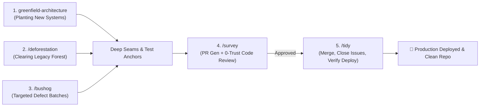
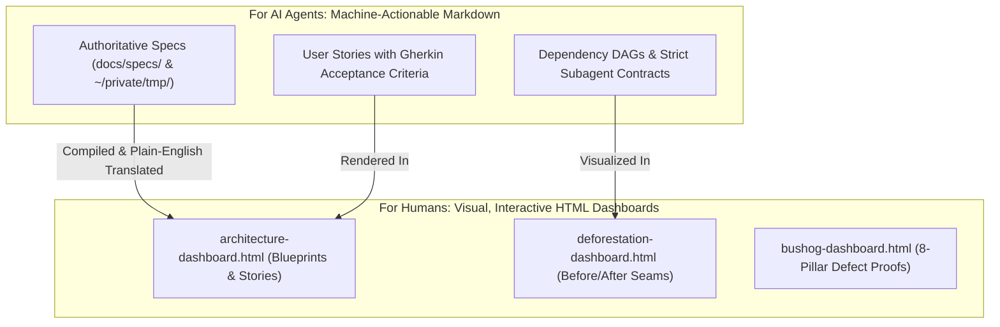

# 🌿 Code Gardening

> **A Complete Agentic Software Engineering Suite for Greenfield Architecture, Legacy De-Spaghettiing, Bug Clearing, 0-Trust Code Review, and Release Finalization.**

[](LICENSE)
[](docs/ARCHITECTURAL-PRINCIPLES.md)
[](docs/WORKFLOWS.md)
[](README.md#dual-audience-documentation)

---

## 📖 Executive Summary

When AI agents and software engineers build or refactor code reactively, systems frequently collapse into **20+ cycles of endless patching**—mixing database queries, UI state, authorization checks, and third-party API calls inside monolithic components and route handlers.

**Code Gardening** is a battle-tested suite of 5 autonomous engineering skills designed to:
1. **Plant Clean Systems from Day 1**: Interrogate humans upfront across 8 architectural pillars to construct deep, modular systems with zero rework.
2. **Clear Legacy Overgrowth**: Systematically modernize legacy spaghetti codebases in a single campaign using context-isolated scanner agents and parallel subagent swarms.
3. **Mow Defect Patches**: Triage and resolve bug batches at their architectural root cause using deterministic red-to-green test anchors.
4. **Survey with Zero Trust**: Generate 100% traceable Pull Requests and submit code to a ruthless, adversarial 0-trust code reviewer.
5. **Tidy the Release**: Merge PRs, close issues with resolution comments, advance project boards, and verify production deployments.

---

## 🛠️ The 5-Skill Lifecycle Suite



| Skill | Invocation | Primary Role | Core Mechanism & Deliverables |
| :--- | :--- | :--- | :--- |
| **`greenfield-architecture`** | Natural / Slash | **Day-1 Architecture** | 8-Pillar upfront interrogation $	o$ Decomposed User Stories $	o$ Auto-opened visual HTML dashboard $	o$ **Mandatory Pause Gate** $	o$ Deep module construction. |
| **`deforestation`** | `/deforestation` | **Brownfield Modernization** | Context-isolated scanners $	o$ Self-contained specs (`docs/specs/`) $	o$ Auto-opened visual HTML dashboard $	o$ **Mandatory Pause Gate** $	o$ **Parallel Subagent Swarms**. |
| **`bushog`** | `/bushog` | **Targeted Defect Clearing** | $1 \dots N$ parallel subagents $	o$ 8-Pillar root-cause fix $	o$ Auto-opened visual HTML defect dashboard $	o$ **Red $	o$ Green test anchors**. |
| **`survey`** | `/survey` | **0-Trust Review Gate & PR** | Acceptance criteria traceability matrix $	o$ **Ruthless 0-trust adversarial reviewer subagent** enforcing 8-pillar compliance before sign-off. |
| **`tidy`** | `/tidy` | **Release & Lifecycle Closure** | Automated PR merge $	o$ Issue closure with resolution notes $	o$ Project board update $	o$ **Live deployment health verification**. |

---

## 🚀 Quick Start & Installation

Clone the repository and run the automated installer:

```bash
# Clone the repository
git clone https://github.com/your-username/code-gardening.git ~/code/code-gardening
cd ~/code/code-gardening

# Run the installation script
./install.sh
```

The installer automatically links or copies all skills into your local agent environment (`~/.gemini/config/skills/`, Claude Code, or Antigravity).

---

## 🏛️ The 8 Pillars of Greenfield Architecture

Every skill in Code Gardening is anchored in **8 Technology-Agnostic Architectural Laws** derived from real-world codebase modernizations:

```mermaid
graph LR
    P1["1. Entities & Cardinality"] --> P2["2. Invariants & Lifecycle"]
    P2 --> P3["3. External Boundaries"]
    P3 --> P4["4. Authorization & Tenancy"]
    P4 --> P5["5. State & Interaction"]
    P5 --> P6["6. Locality & Subsystems"]
    P6 --> P7["7. Projections & Caching"]
    P7 --> P8["8. Anchor Quality Gates"]
```



1. **Domain Entities, Relationships & Cardinality**: Explicit entity typing with zero `any` or ambiguous nullability. Composite aggregate projections eliminate N+1 queries.
2. **Invariants, Compliance & Lifecycle Transitions**: Business rules and audit retention are guaranteed by **Deep Domain Repositories** that automatically execute relational cascades and revision snapshots inside transactions.
3. **External Boundaries & Anti-Corruption Gateways**: Third-party APIs (Stripe, HubSpot, S3, CRMs) are isolated behind authoritative **Gateway classes** with built-in retry policies, PII masking, and mock test drivers.
4. **Authorization & Declarative Policy Guards**: Security is enforced through higher-order wrappers (`withRole()`, `SessionGuard.withAdmin()`) that fail closed and record audit events.
5. **Headless State Models & Pure Presentation**: State machines, form validation, and dirty tracking live in **headless hooks/models**, keeping UI and CLI components purely declarative.
6. **Code Locality & Subsystem Barrels**: Single-consumer code lives with its caller (`app/<route>/`). Shared capabilities live in grouped domain subsystems with explicit `index.ts` barrel facades.
7. **Query Projections & Performance Caching**: High-traffic read paths use unified projection engines to prevent metric drift and redundant recalculation.
8. **Deterministic Anchor Truths**: Automated test suites assert hard architectural constraints (100% Zero-Storage in delivery routes, coverage $\ge 85\%$, zero circular dependencies) from Day 1.

---

## 📊 Dual-Audience Documentation Philosophy

Code Gardening bridges the gap between machine execution and human oversight:



### Plain English Translation Standard
All human-facing HTML dashboards avoid academic jargon and state problems and solutions in plain language:

| Jargon (Avoided in Dashboards) | Plain English Translation (Enforced) |
| :--- | :--- |
| *"Leaky abstraction with direct persistence coupling"* | **"The web page talks directly to the database instead of using a dedicated data manager."** |
| *"Shotgun surgery across shallow adapters"* | **"Changes to one feature force us to edit 5 different files instead of just one."** |
| *"Monolithic presentation component with entangled state dispatch"* | **"One giant 600-line screen is handling visual layout, button clicks, data fetching, and error popups all at once."** |
| *"Enforce immutable provenance snapshots within transactional boundary"* | **"Automatically saves a revision history record whenever a post is updated so nothing is lost."** |
| *"Higher-order declarative policy interception"* | **"A single security check that automatically blocks non-admin users before running actions."** |

---

## 🕹️ Deep-Dive Command Reference

### 1. `greenfield-architecture` (Planting from Day 1)
- **When to use**: Starting a new repository, major feature, or microservice.
- **Workflow**:
  1. Interrogates the human across the 8 Pillars.
  2. Decomposes the blueprint into concrete User Stories and GitHub Issues.
  3. Publishes tracking files to `~/private/tmp/{project-name}/` and GitHub.
  4. Automatically opens `architecture-dashboard.html` in your browser.
  5. **Pauses for Human Confirmation** before writing code.
  6. Implements deep modules, gateways, and anchor tests.

### 2. `/deforestation` (Clearing Legacy Spaghetti)
- **When to use**: Refactoring an existing tangled codebase without iterating 20 times.
- **Workflow**:
  1. Spawns 4 context-isolated scanner subagents (Delivery, Domain, UI State, Integrations).
  2. Scanners write self-contained specs to `docs/specs/SPEC-*.md`.
  3. Automatically opens `deforestation-dashboard.html` with Before/After Mermaid diagrams.
  4. **Pauses for Human Confirmation**.
  5. **Dispatches Parallel Subagent Swarms** across DAG tiers to execute refactors concurrently.
  6. Verifies quality gates and deletes obsolete legacy code.

### 3. `/bushog` (Targeted Defect Clearing)
- **When to use**: Tackling identified bug batches, defect tickets, or test failures.
- **Workflow**:
  1. Partitions bugs across $1 \dots N$ isolated subagents.
  2. Automatically opens `bushog-dashboard.html`.
  3. Subagents audit bugs against the 8 Pillars and write a failing test anchor (**RED**).
  4. Applies root-cause deep fixes and verifies tests turn **GREEN**.

### 4. `/survey` (0-Trust Quality Gate & PR)
- **When to use**: Ready to submit completed work for review.
- **Workflow**:
  1. Compiles git diff into a structured PR with a 100% Acceptance Criteria matrix.
  2. Spawns a **Ruthless 0-Trust Adversarial Code Reviewer Subagent**.
  3. Audits code against the 8 Pillars and attempts to disprove claims.
  4. Emits a structured verdict (`APPROVED`, `REQUEST_CHANGES`, `BLOCKING_VETO`).

### 5. `/tidy` (Release & Lifecycle Closure)
- **When to use**: Merging approved work and releasing to production.
- **Workflow**:
  1. Merges PRs (`--squash` or stacked rebase) and deletes merged branches.
  2. Closes referenced GitHub Issues with detailed resolution comments.
  3. Moves project board cards to `Done`.
  4. Watches CI/CD deployment, executes live HTTP health checks, and outputs an executive release summary.

---

## 📂 Repository Directory Structure

```
code-gardening/
├── LICENSE                            # MIT License
├── README.md                          # Main User Guide & Architecture Manifesto
├── package.json                       # Package metadata
├── install.sh                         # 1-line installation script
├── skills/
│   ├── greenfield-architecture/
│   │   └── SKILL.md                   # Day-1 discovery & deep-module design
│   ├── deforestation/
│   │   ├── SKILL.md                   # Multi-agent legacy de-spaghettiing pipeline
│   │   └── SPEC-TEMPLATE.md           # Authoritative specification contract
│   ├── bushog/
│   │   └── SKILL.md                   # 1..N subagent bug batch clearing
│   ├── survey/
│   │   ├── SKILL.md                   # PR compiler & 0-trust adversarial reviewer
│   │   ├── PR-TEMPLATE.md             # Traceable Pull Request template
│   │   └── REVIEW-RUBRIC.md           # 8-Pillars adversarial review rubric
│   └── tidy/
│       └── SKILL.md                   # Release merge, issue closure & deploy check
└── docs/
    ├── ARCHITECTURAL-PRINCIPLES.md    # In-depth 8-Pillars design laws
    └── WORKFLOWS.md                   # Step-by-step lifecycle walkthroughs
```

---

## 🤝 Contributing

Contributions, enhancements, and new domain rubrics are welcome! Please open an issue or pull request following the `/survey` specification standards.

---

## 📜 License

This project is licensed under the [MIT License](LICENSE).
