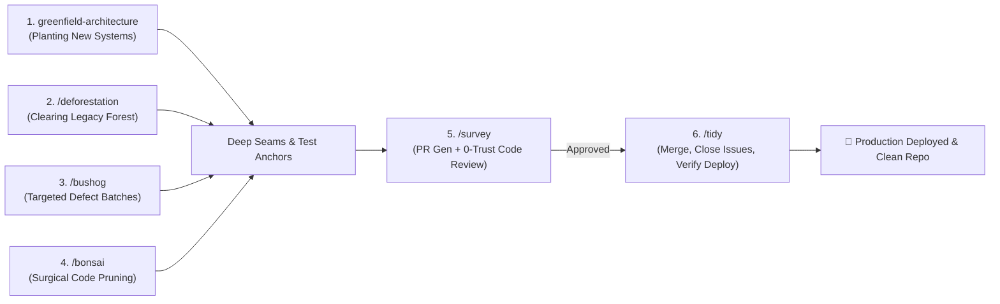
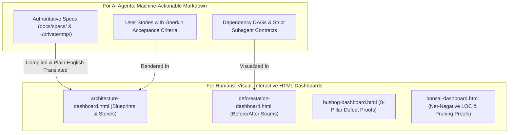

# 🌿 Code Gardening

> **A Complete Agentic Software Engineering Suite for Greenfield Architecture, Legacy De-Spaghettiing, Surgical Code Pruning, Bug Clearing, 0-Trust Code Review, and Release Finalization.**

[](LICENSE)
[](docs/ARCHITECTURAL-PRINCIPLES.md)
[](docs/WORKFLOWS.md)
[](README.md#dual-audience-documentation)

---

## 📖 Executive Summary

When AI agents and software engineers build or refactor code reactively, systems frequently collapse into **20+ cycles of endless patching**—mixing database queries, UI state, authorization checks, and third-party API calls inside monolithic components and route handlers.

**Code Gardening** is a battle-tested suite of 6 autonomous engineering skills designed to:
1. **Plant Clean Systems from Day 1**: Interrogate humans upfront across 8 architectural pillars to construct deep, modular systems with zero rework.
2. **Clear Legacy Overgrowth**: Systematically modernize legacy spaghetti codebases in a single campaign using context-isolated scanner agents and parallel subagent swarms.
3. **Mow Defect Patches**: Triage and resolve bug batches at their architectural root cause using deterministic red-to-green test anchors.
4. **Prune & Compress with Bonsai**: Surgically eliminate dead code, collapse shallow pass-through wrappers, shorten verbose 12-line ceremony into idiomatic 3-line expressions, and replace bloated 1MB libraries with reusable <10KB custom capabilities.
5. **Survey with Zero Trust**: Generate 100% traceable Pull Requests and submit code to a ruthless, adversarial 0-trust code reviewer.
6. **Tidy the Release**: Merge PRs, close issues with resolution comments, advance project boards, and verify production deployments.

---

## 🛠️ The 6-Skill Lifecycle Suite



| Skill | Invocation | Primary Role | Core Mechanism & Deliverables |
| :--- | :--- | :--- | :--- |
| **`greenfield-architecture`** | Natural / Slash | **Day-1 Architecture** | 8-Pillar upfront interrogation $	o$ Decomposed User Stories $	o$ Auto-opened visual HTML dashboard $	o$ **Mandatory Pause Gate** $	o$ Deep module construction. |
| **`deforestation`** | `/deforestation` | **Brownfield Modernization** | Context-isolated scanners $	o$ Self-contained specs (`docs/specs/`) $	o$ Auto-opened visual HTML dashboard $	o$ **Mandatory Pause Gate** $	o$ **Parallel Subagent Swarms**. |
| **`bushog`** | `/bushog` | **Targeted Defect Clearing** | $1 \dots N$ parallel subagents $	o$ 8-Pillar root-cause fix $	o$ Auto-opened visual HTML defect dashboard $	o$ **Red $	o$ Green test anchors**. |
| **`bonsai`** | `/bonsai` | **Surgical Code & Dependency Pruning** | 5 Pruning Shears (`12 -> 3 line` compression, Deletion Test, `1MB lib -> 10KB module`) $	o$ Characterization anchors $	o$ **Net-negative footprint & HTML dashboard**. |
| **`survey`** | `/survey` | **0-Trust Review Gate & PR** | Acceptance criteria traceability matrix $	o$ **Ruthless 0-trust adversarial reviewer subagent** enforcing 8-pillar compliance before sign-off. |
| **`tidy`** | `/tidy` | **Release & Lifecycle Closure** | Automated PR merge $	o$ Issue closure with resolution notes $	o$ Project board update $	o$ **Live deployment health verification**. |

---

## 🚀 Quick Start & Installation

Clone the repository and run the automated installer:

```bash
# Clone the repository
git clone https://github.com/your-username/code-gardening.git ~/code/code-gardening
cd ~/code/code-gardening

# Run the installation script
./install.sh
```

The installer automatically links or copies all skills into your local agent environment (`~/.gemini/config/skills/`, Claude Code, or Antigravity).

---

## 🏛️ The 8 Pillars of Greenfield Architecture

Every skill in Code Gardening is anchored in **8 Technology-Agnostic Architectural Laws** derived from real-world codebase modernizations:

```mermaid
graph LR
    P1["1. Entities & Cardinality"] --> P2["2. Invariants & Lifecycle"]
    P2 --> P3["3. External Boundaries"]
    P3 --> P4["4. Authorization & Tenancy"]
    P4 --> P5["5. State & Interaction"]
    P5 --> P6["6. Locality & Subsystems"]
    P6 --> P7["7. Projections & Caching"]
    P7 --> P8["8. Anchor Quality Gates"]
```



1. **Domain Entities, Relationships & Cardinality**: Explicit entity typing with zero `any` or ambiguous nullability. Composite aggregate projections eliminate N+1 queries.
2. **Invariants, Compliance & Lifecycle Transitions**: Business rules and audit retention are guaranteed by **Deep Domain Repositories** that automatically execute relational cascades and revision snapshots inside transactions.
3. **External Boundaries & Anti-Corruption Gateways**: Third-party APIs (Stripe, HubSpot, S3, CRMs) are isolated behind authoritative **Gateway classes** with built-in retry policies, PII masking, and mock test drivers.
4. **Authorization & Declarative Policy Guards**: Security is enforced through higher-order wrappers (`withRole()`, `SessionGuard.withAdmin()`) that fail closed and record audit events.
5. **Headless State Models & Pure Presentation**: State machines, form validation, and dirty tracking live in **headless hooks/models**, keeping UI and CLI components purely declarative.
6. **Code Locality & Subsystem Barrels**: Single-consumer code lives with its caller (`app/<route>/`). Shared capabilities live in grouped domain subsystems with explicit `index.ts` barrel facades.
7. **Query Projections & Performance Caching**: High-traffic read paths use unified projection engines to prevent metric drift and redundant recalculation.
8. **Deterministic Anchor Truths**: Automated test suites assert hard architectural constraints (100% Zero-Storage in delivery routes, coverage $\ge 85\%$, zero circular dependencies) from Day 1.

---

## 📊 Dual-Audience Documentation Philosophy

Code Gardening bridges the gap between machine execution and human oversight:



### Plain English Translation Standard
All human-facing HTML dashboards avoid academic jargon and state problems and solutions in plain language:

| Jargon (Avoided in Dashboards) | Plain English Translation (Enforced) |
| :--- | :--- |
| *"Leaky abstraction with direct persistence coupling"* | **"The web page talks directly to the database instead of using a dedicated data manager."** |
| *"Shotgun surgery across shallow adapters"* | **"Changes to one feature force us to edit 5 different files instead of just one."** |
| *"Monolithic presentation component with entangled state dispatch"* | **"One giant 600-line screen is handling visual layout, button clicks, data fetching, and error popups all at once."** |
| *"Enforce immutable provenance snapshots within transactional boundary"* | **"Automatically saves a revision history record whenever a post is updated so nothing is lost."** |
| *"Higher-order declarative policy interception"* | **"A single security check that automatically blocks non-admin users before running actions."** |
| *"Transitive dependency bloat with sub-1% symbol utilization"* | **"We installed a 1.4MB library just to format a date that a 15-line helper handles natively."** |

---

## 🕹️ Deep-Dive Command Reference

### 1. `greenfield-architecture` (Planting from Day 1)
- **When to use**: Starting a new repository, major feature, or microservice.
- **Workflow**:
  1. Audits existing repository context and interrogates the human only on unresolved gaps across the 8 Pillars (**Gate 1: Wait for Answers**).
  2. Decomposes the blueprint into `ARCHITECTURE-SPEC.md` and vertical User Stories with Gherkin acceptance criteria.
  3. Publishes tracking files to `~/private/tmp/{project-name}/` and GitHub.
  4. Automatically opens `architecture-dashboard.html` in your browser.
  5. **Pauses for Human Confirmation (Gate 2)** before writing production code.
  6. Implements anchor tests, deep modules, gateways, and thin adapters.

### 2. `/deforestation` (Clearing Legacy Spaghetti)
- **When to use**: Refactoring an existing tangled codebase without iterating 20 times.
- **Workflow**:
  1. Spawns 4 context-isolated read-only scanner subagents (Delivery, Domain, UI State, Integrations).
  2. Orchestrator merges cross-layer findings, assigns a conflict-free Dependency DAG, and writes specs to `docs/specs/SPEC-*.md`.
  3. Automatically opens `deforestation-dashboard.html` with Before/After Mermaid diagrams.
  4. **Pauses for Human Confirmation**.
  5. **Dispatches Parallel Subagent Swarms** across DAG tiers with disjoint file ownership.
  6. Verifies quality gates and deletes obsolete legacy code.

### 3. `/bushog` (Targeted Defect Clearing)
- **When to use**: Tackling identified bug batches, defect tickets, or test failures.
- **Workflow**:
  1. Partitions bugs across $1 \dots N$ isolated subagents with disjoint file scopes.
  2. Subagents diagnose the broken Pillar, write a failing test anchor (**RED**), fix the root cause at the deep seam, and verify tests turn **GREEN**.
  3. Orchestrator runs the full repository test suite to confirm zero regressions.
  4. Compiles the verified root-cause proofs and test anchors into `bushog-dashboard.html` and automatically opens it in your browser.

### 4. `/bonsai` (Surgical Code & Dependency Pruning)
- **Description**: Surgical code pruning, expression compression, dependency weight reduction, and dead-weight elimination while preserving 100% of behavior. Treats both source lines and third-party dependencies as liabilities: if 12 lines of ceremony can be written clearly in 3 lines—or a 1MB library can be replaced by a reusable <10KB custom capability—prune the excess.
- **When to use**: Slimming down a codebase, shortening verbose functions, replacing bloated libraries with lean custom modules, deleting dead or over-engineered code, or running `/bonsai`.
- **The 5 Pruning Shears (`skills/bonsai/PRUNING-PATTERNS.md`)**:
  1. **Shear 1 — Expression & Control-Flow Compression (`12 -> 3 Lines`)**: Replaces imperative accumulator loops with declarative `.filter().map()` pipelines, flattens nested `if/else` pyramids into early-return guard clauses, swaps verbose `switch` chains for lookup maps + nullish coalescing (`??`, `?.`), and strips redundant intermediate variables.
  2. **Shear 2 — The Deletion Test (YAGNI & Shallow Indirection)**: Inlines single-caller wrappers, deletes middleman pass-through services, collapses single-adapter interfaces, and removes speculative config flags never varied by callers.
  3. **Shear 3 — Deduplication & Seam Consolidation**: Collapses copy-pasted route auth/validation/try-catch blocks into declarative Pillar 4 guards, unifies near-duplicate functions, and replaces synchronized `useState` + `useEffect` derived state mirrors with 1-line inline derivations.
  4. **Shear 4 — Dead Code, Zombie Branches & Orphan Purge**: Eliminates unreferenced exports, types, barrel re-exports, unreachable branches, retired feature flags, and commented-out code.
  5. **Shear 5 — Dependency Weight & Library Footprint Pruning (`1MB Library -> 10KB Capability`)**: Audits `node_modules` / bundle weight against actual imported symbols, uninstalling unused packages and replacing oversized libraries (`moment`, `lodash`, `axios`, multi-MB vendor SDKs) with zero-KB native runtime APIs (`fetch`, `Intl`, `structuredClone`, `crypto.randomUUID`) or focused `<10KB` internal modules.
- **Workflow**:
  1. Records baseline LOC, third-party dependency sizes, and test status, then scans against the **5 Pruning Shears**.
  2. Locks any untested public seams with characterization tests (**GREEN**).
  3. Dispatches $1 \dots N$ disjoint subagents to execute the 5 Shears while enforcing **Idiomatic Clarity Over Code Golf** and preserving all **8-Pillar Deep Seams**.
  4. Uninstalls eliminated dependencies, runs the full repository test suite, and proves 0 regressions alongside a strict net-negative footprint.
  5. Compiles Before/After code comparisons, a Dependency Diet Table (MB/KB saved), and compression metrics into `bonsai-dashboard.html` and automatically opens it in your browser.

### 5. `/survey` (0-Trust Quality Gate & PR)
- **When to use**: Ready to submit completed work for review.
- **Workflow**:
  1. Compiles changes into a structured PR with a 100% Acceptance Criteria matrix.
  2. Spawns an **Independent 0-Trust Adversarial Code Reviewer Subagent** that inspects the diff, surrounding callers, and test runs against `REVIEW-RUBRIC.md`.
  3. Emits a structured verdict (`APPROVED`, `REQUEST_CHANGES`, `BLOCKING_VETO`) with a bounded 3-round remediation loop.

### 6. `/tidy` (Release & Lifecycle Closure)
- **When to use**: Merging approved work and releasing to production.
- **Workflow**:
  1. Merges PRs (`--squash` or safe stacked PR retarget/rebase) and deletes merged branches.
  2. Closes referenced GitHub Issues and local specs with resolution comments.
  3. Moves project board cards to `Done` (when present).
  4. Watches CI/CD deployment, executes live HTTP health checks (or local production build fallback), and outputs a release summary.

---

## 📂 Repository Directory Structure

```
code-gardening/
├── LICENSE                            # MIT License
├── README.md                          # Main User Guide & Architecture Manifesto
├── package.json                       # Package metadata
├── install.sh                         # 1-line installation script
├── skills/
│   ├── greenfield-architecture/
│   │   ├── SKILL.md                   # Day-1 discovery & deep-module construction
│   │   ├── PILLARS.md                 # Disclosed reference: 8 Pillars & 5-Tier Seam laws
│   │   └── DASHBOARD-STYLE.md         # Disclosed reference: Plain-English HTML & Mermaid spec
│   ├── deforestation/
│   │   ├── SKILL.md                   # Multi-agent legacy de-spaghettiing pipeline
│   │   └── SPEC-TEMPLATE.md           # Authoritative specification contract with Owned Files
│   ├── bushog/
│   │   └── SKILL.md                   # 1..N subagent bug batch clearing
│   ├── bonsai/
│   │   ├── SKILL.md                   # Surgical code pruning & net-negative LOC pipeline
│   │   └── PRUNING-PATTERNS.md        # Disclosed reference: 5 Pruning Shears & 12->3 line patterns
│   ├── survey/
│   │   ├── SKILL.md                   # PR compiler & 0-trust adversarial reviewer
│   │   ├── PR-TEMPLATE.md             # Traceable Pull Request template
│   │   └── REVIEW-RUBRIC.md           # 8-Pillars adversarial review rubric
│   └── tidy/
│       └── SKILL.md                   # Release merge, issue closure & deploy check
└── docs/
    ├── ARCHITECTURAL-PRINCIPLES.md    # In-depth 8-Pillars design laws
    └── WORKFLOWS.md                   # Step-by-step lifecycle walkthroughs
```

---

## 🤝 Contributing

Contributions, enhancements, and new domain rubrics are welcome! Please open an issue or pull request following the `/survey` specification standards.

---

## 📜 License

This project is licensed under the [MIT License](LICENSE).
