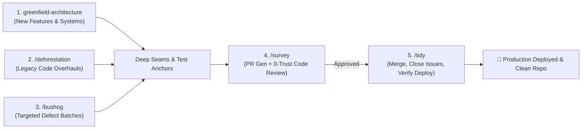

# Code Gardening Workflows & Lifecycle Guide

This guide walks through the complete end-to-end software development lifecycle using the Code Gardening skill suite.

---

## Workflow 1: Building a New Feature or Project (`greenfield-architecture`)

1. **Context Audit & Discovery (Gate 1)**:
   - The agent inspects the repository first, then asks targeted questions covering only the unresolved gaps across the 8 Pillars and waits for your answers.
2. **Specifications & User Stories**:
   - Once answered, the agent writes `ARCHITECTURE-SPEC.md` and decomposes it into vertical User Stories with Gherkin acceptance criteria (`~/private/tmp/{project-name}/` and GitHub).
3. **Inspect the Visual HTML Dashboard (Gate 2)**:
   - The agent opens `architecture-dashboard.html` in your browser and pauses for confirmation.
   - Respond with `"Proceed"` or request adjustments.
4. **Immediate Construction**:
   - The agent scaffolds failing anchor tests (`RED`), builds deep domain modules/gateways, wires thin delivery adapters (`<30 lines`), and verifies `GREEN`.

---

## Workflow 2: Modernizing a Legacy Spaghetti Codebase (`/deforestation`)

1. **Invoke `/deforestation`**:
   - The orchestrator spawns 4 context-isolated read-only scanner subagents (Delivery, Domain, UI State, Integrations).
2. **Seam Deduplication & Modernization Plan**:
   - The orchestrator merges cross-layer findings into unified vertical seams with disjoint file scopes, writes `docs/specs/SPEC-*.md`, and opens `deforestation-dashboard.html` in your browser.
3. **Approve to Proceed (Human-in-the-Loop Gate)**:
   - The orchestrator pauses and waits for your confirmation.
4. **Tiered Swarm Fan-Out**:
   - The orchestrator dispatches parallel subagent swarms tier by tier across the Dependency DAG.
   - Workers refactor modules, write unit tests, and report back.
5. **Verification & Cutover**:
   - Full test suite and anchor checks pass, legacy dead code is deleted, and the dashboard is updated to green.

---

## Workflow 3: Clearing Bug Batches (`/bushog`)

1. **Invoke `/bushog`** with a list of issues, stack traces, or failing tests.
2. **Triage & Disjoint Worker Allocation**:
   - The orchestrator partitions bugs across $1 \dots N$ subagents with strictly non-overlapping file scopes.
3. **8-Pillars Root-Cause Rectification**:
   - Each subagent identifies the broken Pillar, writes a failing test anchor (`RED`), fixes the bug at the deep domain seam, and verifies the subsystem suite turns `GREEN`.
4. **Repository Verification & Visual Proof Dashboard**:
   - Full repository test suite passes with zero regressions, and the orchestrator opens `bushog-dashboard.html` displaying the verified root causes, Before/After diagrams, and test anchors.

---

## Workflow 4: Quality Gate & PR Review (`/survey`)

1. **Invoke `/survey`** on completed work.
2. **PR Compilation**:
   - Extracts git diff, links originating specs/tickets, and creates a 100% checkable Acceptance Criteria matrix.
3. **0-Trust Adversarial Code Review**:
   - Spawns an independent subagent with a zero-trust mandate.
   - Audits code against the 8 Pillars and attempts to disprove claims.
   - Emits a structured verdict (`APPROVED`, `REQUEST_CHANGES`, `BLOCKING_VETO`).

---

## Workflow 5: Release & Lifecycle Closure (`/tidy`)

1. **Invoke `/tidy`** once a PR is approved.
2. **Pre-Merge Health Check**: Verifies CI/CD checks and tree cleanliness.
3. **Merge & Clean**: Merges PR (Squash/Rebase) and deletes the feature branch.
4. **Close Issues**: Updates referenced GitHub Issues/tickets to `Closed` with resolution comments.
5. **Project Board**: Moves cards to `Done`.
6. **Deployment Check**: Watches build pipeline, verifies HTTP 200 health check, and outputs a release summary.
