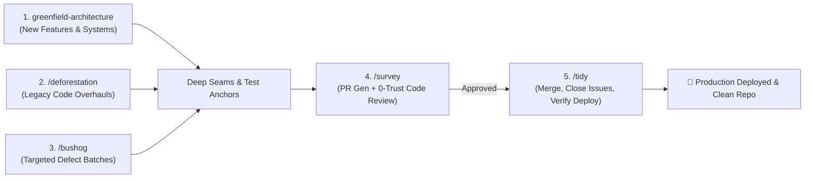

# Code Gardening Workflows & Lifecycle Guide

This guide walks through the complete end-to-end software development lifecycle using the Code Gardening skill suite.

---

## Workflow 1: Building a New Feature or Project (`greenfield-architecture`)

1. **Invoke the Skill**: The agent begins by asking targeted discovery questions across the 8 Pillars.
2. **Review the Specifications & User Stories**:
   - The agent writes the system architecture specification and decomposes it into vertical User Stories with Gherkin acceptance criteria.
   - Publishes tickets locally (`~/private/tmp/{project-name}/`) and to GitHub.
3. **Inspect the Visual HTML Dashboard**:
   - The agent opens `architecture-dashboard.html` in your browser.
   - Review the Before/After blueprints and user stories.
4. **Approve to Proceed (Human-in-the-Loop Gate)**:
   - The agent pauses and waits. Respond with `"Proceed"` or request adjustments.
5. **Immediate Construction**:
   - The agent scaffolds anchor tests, builds deep domain modules/gateways, and wires thin delivery adapters.

---

## Workflow 2: Modernizing a Legacy Spaghetti Codebase (`/deforestation`)

1. **Invoke `/deforestation`**:
   - The orchestrator spawns 4 context-isolated scanner subagents (Delivery, Domain, UI State, Integrations).
2. **Review the Modernization Plan**:
   - Scanners write self-contained specs to `docs/specs/`.
   - The orchestrator compiles and automatically opens `deforestation-dashboard.html` in your browser.
3. **Approve to Proceed (Human-in-the-Loop Gate)**:
   - The orchestrator pauses and waits for your confirmation.
4. **Swarm Fan-Out Execution**:
   - The orchestrator constructs a dependency DAG and dispatches parallel subagent swarms across independent tiers.
   - Workers refactor modules, write unit tests, and report back.
5. **Verification & Cutover**:
   - All tests pass, legacy dead code is deleted, and the codebase is completely modernized in a single campaign.

---

## Workflow 3: Clearing Bug Batches (`/bushog`)

1. **Invoke `/bushog`** with a list of issues or defect tickets.
2. **Triage & Worker Allocation**:
   - The orchestrator sizes $1 \dots N$ subagents based on subsystem boundaries.
   - Automatically opens `bushog-dashboard.html` showing root-cause analysis.
3. **8-Pillars Root-Cause Rectification**:
   - Each subagent writes a failing test anchor (RED).
   - Fixes the bug at the deep domain seam (not a shallow UI patch).
   - Verifies the test passes (GREEN).
4. **Regression Verification**:
   - Full test suite passes with zero regressions.

---

## Workflow 4: Quality Gate & PR Review (`/survey`)

1. **Invoke `/survey`** on completed work.
2. **PR Compilation**:
   - Extracts git diff, links originating specs/tickets, and creates a 100% checkable Acceptance Criteria matrix.
3. **0-Trust Adversarial Code Review**:
   - Spawns an independent subagent with a zero-trust mandate.
   - Audits code against the 8 Pillars and attempts to disprove claims.
   - Emits a structured verdict (`APPROVED`, `REQUEST_CHANGES`, `BLOCKING_VETO`).

---

## Workflow 5: Release & Lifecycle Closure (`/tidy`)

1. **Invoke `/tidy`** once a PR is approved.
2. **Pre-Merge Health Check**: Verifies CI/CD checks and tree cleanliness.
3. **Merge & Clean**: Merges PR (Squash/Rebase) and deletes the feature branch.
4. **Close Issues**: Updates referenced GitHub Issues/tickets to `Closed` with resolution comments.
5. **Project Board**: Moves cards to `Done`.
6. **Deployment Check**: Watches build pipeline, verifies HTTP 200 health check, and outputs a release summary.
