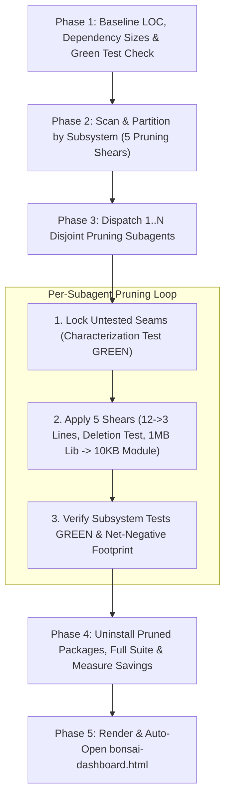

# Bonsai (`/bonsai`)

Treat code and third-party dependencies as liabilities, not assets. Surgically prune dead code, collapse shallow pass-throughs, compress verbose 12-line blocks into idiomatic 3-line expressions, and replace bloated 1MB libraries with reusable <10KB internal capabilities—while preserving 100% of observable functionality and architectural depth.

Read [`PRUNING-PATTERNS.md`](PRUNING-PATTERNS.md) for the **5 Pruning Shears** and safety guardrails, [`../greenfield-architecture/PILLARS.md`](../greenfield-architecture/PILLARS.md) for the **8 Pillars**, and [`../greenfield-architecture/DASHBOARD-STYLE.md`](../greenfield-architecture/DASHBOARD-STYLE.md) for HTML dashboard formatting.



---

## Phase 1: Baseline Snapshot & Scope Sizing

1. **Record the Starting Baseline**:
   - Measure baseline source line counts (`git ls-files <scope> | xargs wc -l`), inspect third-party dependency sizes (`package.json` + `du -sh node_modules/* 2>/dev/null | sort -hr | head -n 25` or language equivalent), and verify the existing test suite and typechecker pass (`GREEN`).
   - **Shared Context Check (When Present — Optional)**: If `GLOSSARY.md` or `docs/specs/` exist in the repository, read them so any newly extracted `<10KB` module or consolidated guard uses canonical project terminology and preserves documented seam contracts. (`/bonsai` never requires these files and runs 100% standalone when they are absent.)
2. **Choose Execution Topology by Scope**:

| Target Scope | Execution Mode | Worker Allocation |
| :--- | :--- | :--- |
| **Targeted Files / Single Subsystem / PR Diff** | Direct or 1 Subagent | Audit and prune directly (or via 1 subagent) with zero orchestration overhead. |
| **Multi-Subsystem / Full Repository** | Parallel Scanner $\rightarrow$ Worker Swarm | Spawn $1 \dots N$ read-only `research` scanners by subsystem, deduplicate cross-file cuts, and dispatch disjoint `self` workers in a single `invoke_subagent` call. |

---

## Phase 2: Multi-Shear Bloat & Dependency Weight Audit

Scan the target scope against the **5 Pruning Shears** in [`PRUNING-PATTERNS.md`](PRUNING-PATTERNS.md):

1. **Shear 1 — Expression & Control-Flow Compression (`12 -> 3 Lines`)**:
   - Imperative accumulator loops replaceable by `.filter().map()`, `.find()`, `.some()`, `Object.fromEntries()`.
   - Deeply nested `if/else` pyramids replaceable by flat early-return guard clauses.
   - Verbose `switch` / `if-else` ladders replaceable by lookup tables and nullish coalescing (`??`, `?.`).
   - Redundant temporary variables, boolean return ceremony, and manual property copying.
2. **Shear 2 — The Deletion Test (YAGNI & Shallow Indirection)**:
   - Single-caller helper functions/files that add indirection without isolating complexity (inline them).
   - Pass-through service wrappers that merely forward calls to a repository or gateway (delete the middleman).
   - One-adapter interfaces, abstract factories, and speculative option flags never varied by any caller.
3. **Shear 3 — Deduplication & Seam Consolidation**:
   - Copy-pasted auth checks, input parsing, or `try/catch` envelopes across routes (collapse into a single Pillar 4 / Pillar 1 guard).
   - Near-duplicate functions differing only by a parameter or predicate.
   - Synchronized derived UI state (`useState` + `useEffect` mirroring props) replaceable by 1-line inline derivation.
4. **Shear 4 — Dead Code, Zombie Branches & Orphan Files**:
   - Unreferenced exports, types, internal helpers, barrel re-exports, zombie feature flags, unreachable branches, and commented-out code.
5. **Shear 5 — Dependency Weight & Library Footprint Pruning (`1MB Library -> 10KB Custom Capability`)**:
   - Audit installed libraries against their actual call-site usage across the repository.
   - Flag unused packages (0 imports) for immediate removal.
   - Flag heavy packages (`>100KB–1MB+`, e.g., `moment`, `lodash`, `axios`, oversized vendor SDKs, heavy utility/CSV/date/validation packages) imported for only 1–3 narrow features. Replace them with either **zero-KB native platform primitives** (`fetch`, `Intl`, `crypto.randomUUID`, `structuredClone`, `URLSearchParams`) or a **reusable <10KB (20–100 line) internal deep module / Pillar 3 Gateway** with full unit test coverage.

### Partitioning Rule for Parallel Workers
Group findings into subsystem work packages with **strictly disjoint file ownership**. If replacing a shared third-party library or deleting a dead export touches multiple subsystems, either build the replacement `<10KB` internal module in Tier 1 before updating callers, or execute the cross-cutting swap and `npm uninstall` at the orchestrator barrier.

---

## Phase 3: Test-Anchored Pruning Execution ($1 \dots N$ Workers)

For each subsystem work package, execute directly (if single-scope) or dispatch concurrent write-capable `self` subagents (`invoke_subagent` in a single call) with this contract:

```text
You are a surgical pruning worker in the /bonsai pipeline.

OWNED SUBSYSTEM / FILES: [Exclusive file paths]
PRUNING TARGETS: [Identified Shear 1..5 opportunities & heavy libraries to replace]
REFERENCE: Read `~/.gemini/config/skills/bonsai/PRUNING-PATTERNS.md` and `~/.gemini/config/skills/greenfield-architecture/PILLARS.md` (or the repo's `skills/` equivalents if running from a local checkout). If `GLOSSARY.md` exists at the repository root, use its canonical domain and seam names.

EXECUTION MANDATE:
1. CHARACTERIZATION ANCHOR FIRST: Before pruning any function or replacing a third-party library seam that lacks test coverage, write a concise characterization test locking its current inputs, outputs, and error behavior. Confirm it passes (GREEN).
2. APPLY THE 5 PRUNING SHEARS:
   - Compress verbose 12-line loops, nested conditionals, and switches into clear 3-line expressions, guard clauses, or lookup maps.
   - Inline single-caller pass-through wrappers and delete speculative parameters (The Deletion Test).
   - Consolidate duplicate validation/mapping blocks.
   - Delete dead functions, unused types, zombie branches, and commented-out code.
   - Replace bloated third-party libraries with native runtime APIs or a focused <10KB reusable internal capability behind a clean seam.
3. GUARDRAILS:
   - Write flat, typed, step-debuggable expressions (guard clauses, lookup maps, `.filter().map()` pipelines) rather than nested ternaries or obfuscated "code golf" 1-liners.
   - Prune *inside* deep modules and *at* thin adapters while keeping every 5-Tier seam (Repository, Gateway, Policy Guard, Headless State Model) intact behind its public interface.
4. VERIFY GREEN & NET-NEGATIVE FOOTPRINT:
   - Run the subsystem test suite and typechecker until 100% GREEN.
   - Run `git diff --stat -- <owned-files>` and verify either net-negative source LOC (`lines deleted > lines added`) or elimination of a heavy external dependency in exchange for a compact (<10KB) internal module.

RETURN PAYLOAD:
- Subsystem name and files pruned/deleted
- Before LOC vs. After LOC (net lines removed & percentage reduction)
- Dependencies replaced/removed: Package name, previous library size (KB/MB), and new custom capability size (KB / lines)
- Top 1..3 concrete Before/After code snippets (showing e.g. 12 lines -> 3 lines or 1MB library -> 10KB capability)
- Shear categories applied (Shear 1..5) and plain-English explanation of why each cut is safer and cleaner
- Test runner & typecheck verification summary
```

After launching concurrent subagents, stop calling tools and wait for all workers to complete.

---

## Phase 4: Dependency Uninstall, Cross-Codebase Sweep & Full Verification

Once all subsystem pruning finishes:
1. **Uninstall Replaced & Dead Packages**: Remove every eliminated library from the package manifest (`npm uninstall <pkg>`, `pnpm remove <pkg>`, `cargo rm <pkg>`, etc.) and record the reduction in `node_modules` / bundle / lockfile weight.
2. **Orphan & Barrel Sweep**: Delete any newly unreferenced shared helpers or stale barrel exports exposed by the subsystem cuts.
3. **Full Repository Verification**: Run the complete test suite, typechecker, linter, and production build at the repository root. Confirm **0 regressions** and **0 unused-symbol warnings**.
4. **Measure Final Compression**: Run `git diff --shortstat` (excluding lockfiles) to capture source LOC saved, plus total package weight (KB/MB) eliminated.

---

## Phase 5: Visual HTML Bonsai Dashboard

Set `PROJECT_NAME` (`basename "$(git rev-parse --show-toplevel 2>/dev/null || pwd)"`) and `OUT_DIR="$HOME/private/tmp/${PROJECT_NAME}"`.

Compile the pruning results into `${OUT_DIR}/bonsai-dashboard.html` following [`../greenfield-architecture/DASHBOARD-STYLE.md`](../greenfield-architecture/DASHBOARD-STYLE.md) (plain English, zero academic jargon, live Mermaid ESM script):
1. **Executive Compression Scorecard**:
   - **Total Source Lines Removed (Net Negative Diff)** & **Compression Ratio (%)**
   - **Library Weight Eliminated (MB / KB Saved)** *(e.g., "Removed 2.4 MB of heavy libraries → Replaced with 8 KB custom modules")*
   - **Dead Files / Exports / Packages Purged**
   - **Test Suite Status (`100% GREEN`)**
2. **Dependency Diet Table (When Libraries Were Replaced)**:
   - Package removed, original size (`MB`/`KB`), replacement approach (`Native Runtime API` or `Reusable <10KB Custom Module`), and net weight saved.
3. **Before vs. After Pruning Cards (Grouped by Shear 1..5)**:
   - **Shear Badge**: e.g., `Shear 1: 14 Lines → 3 Lines`, `Shear 2: Collapsed Pass-Through Layer`, `Shear 5: 1.2 MB Library → 4 KB Custom Module`.
   - **Plain-English Summary**: *What bloat existed?*, *How did we shorten or replace it?*, and *Why less code/weight helps here*.
   - **Side-by-Side Code & Mermaid Comparison**: Exact Before vs. After code blocks and `<pre class="mermaid">` diagrams when architectural layers or heavy external dependencies were replaced.

Automatically open the dashboard in the user's browser:
```bash
open "${OUT_DIR}/bonsai-dashboard.html"
```
