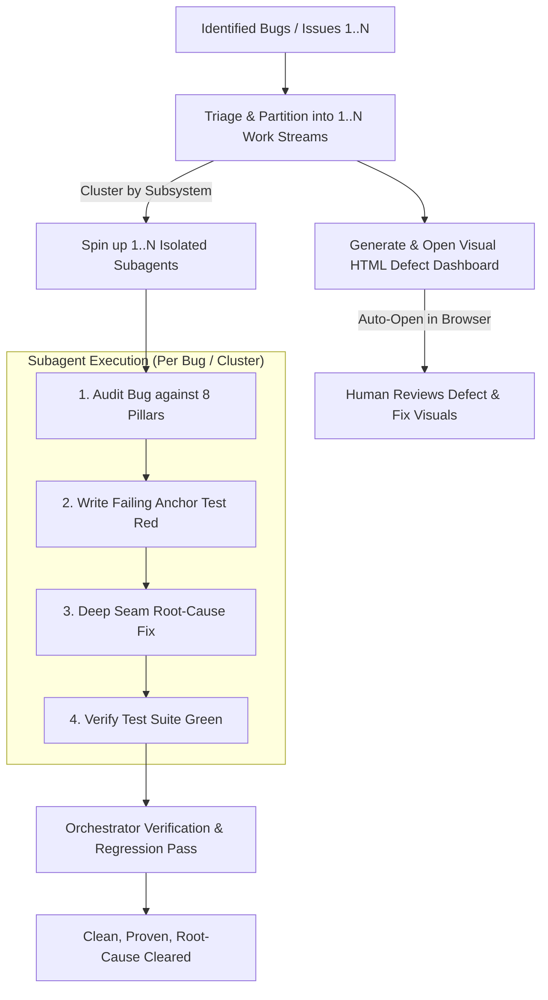
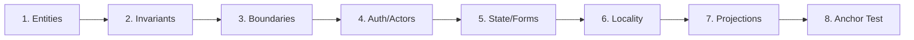

# Bush Hog (/bushog)

A high-precision, rapid-clearing pipeline for tackling identified bugs, defects, test failures, and localized regressions. 

Where `/deforestation` is a large-scale campaign to dismantle an entire legacy codebase, `/bushog` is the tactical rotary mower that clears overgrown patches of bugs with speed, precision, and architectural discipline.

Instead of applying shallow "band-aid" patches (like inline null-checks or symptom-masking in UI routes), `/bushog` uses **1 to N parallel subagents** that analyze each bug through the **8 Pillars of Greenfield Architecture**, write deterministic failing tests, fix the root cause inside deep modules, and **generate an interactive HTML defect dashboard** automatically opened for the human.



---

## Phase 1: Triage & Worker Sizing ($1 \dots N$)

The Orchestrator assesses the incoming list of bugs/issues and sizes the subagent fan-out:

| Bug Batch Shape | Subagent Allocation | Strategy |
| :--- | :--- | :--- |
| **Single Isolated Bug** | **1 Subagent** | Direct deep-dive execution. |
| **Multiple Bugs in Same Subsystem** | **1 Subagent** | Batch execution to prevent file edit collisions. |
| **Multiple Independent Bugs across Distinct Subsystems** | **$N$ Subagents (Parallel)** | Concurrently dispatched with isolated contexts. |
| **Flaky / Hard-to-Reproduce Race Conditions** | **1 Subagent + Diagnostic Trace** | Reproduce deterministically before attempting a fix. |

### Anti-Collision Rule:
Never assign two concurrent subagents to touch the same file. Partition bugs strictly by domain boundary or subsystem directory.

---

## Phase 2: Human-Facing Visual HTML Defect Dashboard

Humans should not have to parse dense terminal test traces to understand what went wrong and how it was fixed. The agent **MUST** generate a visual HTML report (`~/private/tmp/{project-name}/bushog-dashboard.html` or `/tmp/bushog-<timestamp>.html`) and automatically open it in the default browser:

```bash
# Auto-open command executed by the agent:
open ~/private/tmp/{project-name}/bushog-dashboard.html
```


### Plain English Writing Mandate for Human-Facing Dashboards:
When generating HTML reports for humans, **write in clear, simple, plain English**. Do NOT use unnecessary academic or overly dense jargon. Only use technical architectural terms when strictly necessary to reference a specific file, tool, type, or function.

#### Jargon vs. Plain English Guide:
| Jargon (Avoid in HTML Reports) | Plain English Translation (Use This) |
| :--- | :--- |
| "Leaky abstraction with direct persistence coupling" | "The web page talks directly to the database instead of using a dedicated data manager." |
| "Shotgun surgery across shallow adapters" | "Changes to one feature force us to edit 5 different files instead of just one." |
| "Monolithic presentation component with entangled state dispatch" | "One giant 600-line screen is handling visual layout, button clicks, data fetching, and error popups all at once." |
| "Enforce immutable provenance snapshots within transactional boundary" | "Automatically saves a revision history record whenever a post is updated so nothing is lost." |
| "Higher-order declarative policy interception" | "A single security check that automatically blocks non-admin users before running actions." |
| "Anti-corruption gateway isolating vendor telemetry payload serialization" | "A dedicated integration helper that formats data for HubSpot/Stripe so external changes don't break our app." |

#### Plain English Card Format:
- **What is the problem?** (1-2 simple sentences explaining what hurts or where bugs happen).
- **How are we fixing it?** (1-2 simple sentences explaining the clean new structure).
- **Why this helps:** (Short 3-5 word bullet points like "Bugs are fixed in one place", "Prevents unauthorized edits", "Cuts 400 lines of messy code").

### What the HTML Defect Dashboard Contains:
1. **Executive Defect Header**: Total bugs identified, worker subagents active, test pass rate, and regression anchor status.
2. **Defect Cards (Per Bug / Cluster)**:
   - **8-Pillars Root Cause Breakdown**: Badges highlighting which pillar failed (e.g., `Pillar 2: Bypassed Invariant`, `Pillar 3: Leaked Vendor Exception`).
   - **Symptom vs. Root Cause**: Plain-language description of why the crash happened.
   - **Before (Shallow Symptom) vs. After (Deep Fix) Diagrams**: Side-by-side Mermaid diagrams illustrating the architectural resolution.
   - **Deterministic Test Anchor**: Code snippet of the reproduction test proving the fix turned from RED to GREEN.

---

## Phase 3: The 8-Pillar Bug Rectification Audit

Every bug fix subagent **MUST NOT** simply patch symptoms at the point of failure. It must audit the bug against the **8 Pillars of Greenfield Architecture** to locate the real architectural breakdown:



1. **Entity & Cardinality Check**: Is the bug caused by malformed data shapes, undefined optional properties, or invalid relational assumptions?
2. **Invariant & Compliance Check**: Did a code path mutate state while bypassing a mandatory lifecycle rule, validation schema, or audit log?
3. **External Boundary Check**: Is an unhandled third-party API error, timeout, or leaking vendor payload crashing the system? (If so, encapsulate it in an Anti-Corruption Gateway).
4. **Authorization & Actor Check**: Did an endpoint or action fail to enforce actor permissions or tenancy boundaries via declarative guards?
5. **State & Interaction Check**: Is UI state out of sync due to unmanaged side effects, missing optimistic rollback, or bloated state variables? (If so, extract a headless hook).
6. **Code Locality Check**: Is the bug caused by circular imports, conflicting duplicate utility functions, or stranded components?
7. **Projection & Performance Check**: Is the bug caused by stale cache data, metric calculation drift, or N+1 query timeouts?
8. **Deterministic Anchor Test**: **MANDATORY**: Before writing a fix, write an automated test that reproduces the bug and fails (**RED**).

---

## Phase 4: Subagent Execution Contract

When the Orchestrator launches an implementation subagent, it passes this structured contract:

```text
You are an expert software engineer resolving an identified defect using /bushog.

BUG IDENTIFIER: [Issue / Bug Description]
AFFECTED SUBSYSTEM: [File paths / Module names]
REFERENCE SKILL: Consult the "greenfield-architecture" 8-pillar principles.

YOUR 4-STEP MANDATE:
1. REPRODUCE: Write an automated test case that fails deterministically on the current codebase (RED).
2. ROOT-CAUSE FIX: Apply the fix at the deepest appropriate seam (Domain Repository, Gateway, Guard, or Headless Hook). Do NOT apply shallow band-aids in presentation or delivery layers.
3. VERIFY: Run the test suite to confirm your reproduction test is now passing (GREEN) and 100% of existing tests remain passing.
4. CLEANUP: Ensure types pass with 0 errors and no dead code is left behind.

Report back with:
- The root cause identified (referencing the relevant 8 Pillars).
- The reproduction test added.
- The files modified.
- Verification test run output.
```

---

## Phase 5: Verification & Quality Gate

Once all 1 to $N$ subagents complete their work:
1. **Full Test Suite Run**: Orchestrator runs the complete test suite across the repository to guarantee zero regressions.
2. **Anchor Assertions**: Verify that every bug has a permanent regression test added to the test suite.
3. **Update Visual Dashboard**: Refresh `bushog-dashboard.html` with final green status and anchor test metrics.
