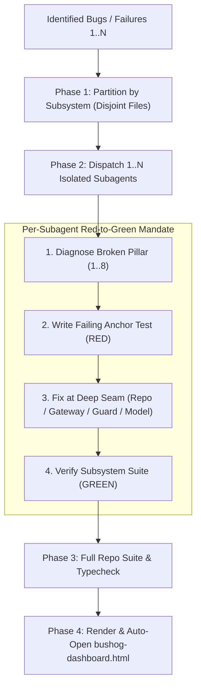

# Bush Hog (`/bushog`)

Clear bugs, defect batches, and test failures at their architectural root cause using **$1 \dots N$ isolated subagents**, deterministic **Red -> Green** test anchors, and a visual HTML proof dashboard.

Read [`../greenfield-architecture/PILLARS.md`](../greenfield-architecture/PILLARS.md) for the **8 Pillars** and [`../greenfield-architecture/DASHBOARD-STYLE.md`](../greenfield-architecture/DASHBOARD-STYLE.md) for HTML dashboard formatting.



---

## Phase 1: Triage & Subsystem Partitioning ($1 \dots N$)

Map each incoming bug, failing test, or issue to the subsystem and files it touches, then size the worker fan-out:

| Bug Batch Shape | Worker Allocation | Partitioning Rule |
| :--- | :--- | :--- |
| **Single Isolated Bug** | 1 Subagent (or direct if trivial) | Single subsystem scope. |
| **Multiple Bugs in the Same Subsystem / Files** | 1 Subagent (batched) | Group together so one worker owns the shared files sequentially. |
| **Multiple Bugs across Independent Subsystems** | $N$ Concurrent Subagents | Launch in a single `invoke_subagent` call with strictly disjoint file scopes. |
| **Flaky / Timing / Race Condition Bug** | 1 Subagent | Deterministically reproduce with controlled clock/concurrency before fixing. |

---

## Phase 2: Parallel Subagent Dispatch (Red -> Green)

For each partitioned work stream, launch a write-capable `self` subagent with this self-contained contract:

```text
You are resolving assigned defect(s) in the /bushog pipeline.

ASSIGNED DEFECT(S): [Bug IDs, symptoms, stack traces, or failing test names]
OWNED SUBSYSTEM / FILES: [Exclusive directory or file paths]
ARCHITECTURAL LAWS: Read `~/.gemini/config/skills/greenfield-architecture/PILLARS.md`.

EXECUTION MANDATE:
1. DIAGNOSE PILLAR BREAKDOWN: Identify which of the 8 Pillars failed at the root cause:
   - Pillar 1 (Entities/Types): Malformed shape, unchecked nullability, N+1 assumption.
   - Pillar 2 (Invariants/Lifecycle): State mutation bypassing transaction, validation, or audit log.
   - Pillar 3 (External Boundaries): Unhandled vendor error, timeout, or leaked SDK payload outside a Gateway.
   - Pillar 4 (Auth/Guards): Missing or inconsistent declarative role/tenant guard.
   - Pillar 5 (Headless State): Out-of-sync UI state, unmanaged side effect, or missing rollback in a state model.
   - Pillar 6 (Locality/Barrels): Circular import or duplicate divergent helper.
   - Pillar 7 (Projections/Cache): Stale cache invalidation or drifted rollup calculation.
2. REPRODUCE (RED): Write an automated test at the module's public interface that deterministically fails on the bug and observe the RED failure output.
3. DEEP SEAM FIX: Fix the root cause inside the deep module (Domain Repository, Anti-Corruption Gateway, Declarative Guard, or Headless State Model) rather than masking symptoms in a route or view.
4. VERIFY (GREEN): Run the subsystem test suite and typechecker until your new anchor test and all existing tests pass with 0 errors.

RETURN PAYLOAD:
- Defect ID & Title
- Violated Pillar (1..8)
- Plain-English Symptom vs. Root Cause (1-2 sentences each)
- Before vs. After Mermaid diagram snippet
- Exact file path and code snippet of the new RED-to-GREEN anchor test
- Modified production files and test runner summary
```

After launching the subagent batch via `invoke_subagent`, stop calling tools and wait for all workers to report back.

---

## Phase 3: Full Repository Verification

Once all $1 \dots N$ subagents finish:
1. Run the full repository test suite, typechecker, and linter once to confirm zero cross-subsystem regressions.
2. Verify that every resolved defect has a permanent regression test committed in the test suite.

---

## Phase 4: Visual HTML Defect Dashboard

Set `PROJECT_NAME` (`basename "$(git rev-parse --show-toplevel 2>/dev/null || pwd)"`) and `OUT_DIR="$HOME/private/tmp/${PROJECT_NAME}"`.

Compile the verified subagent payloads into `${OUT_DIR}/bushog-dashboard.html` following [`../greenfield-architecture/DASHBOARD-STYLE.md`](../greenfield-architecture/DASHBOARD-STYLE.md) (plain English, zero academic jargon, live Mermaid ESM script):
1. **Executive Defect Scorecard**: Total bugs cleared, subagents dispatched, full suite pass rate, and new regression anchors added.
2. **Per-Defect Proof Cards**:
   - **Broken Pillar Badge**: e.g., `Pillar 2: Bypassed Invariant` or `Pillar 3: Unhandled Vendor Timeout`.
   - **Plain-English Diagnosis**: *What broke?*, *How did we fix the root cause?*, and *Why this prevents repeat bugs*.
   - **Before (Symptom) vs. After (Deep Seam Fix)**: Side-by-side `<pre class="mermaid">` diagrams.
   - **Red -> Green Anchor Proof**: Code snippet and file link of the automated regression test.

Automatically open the dashboard for the human:
```bash
open "${OUT_DIR}/bushog-dashboard.html"
```
