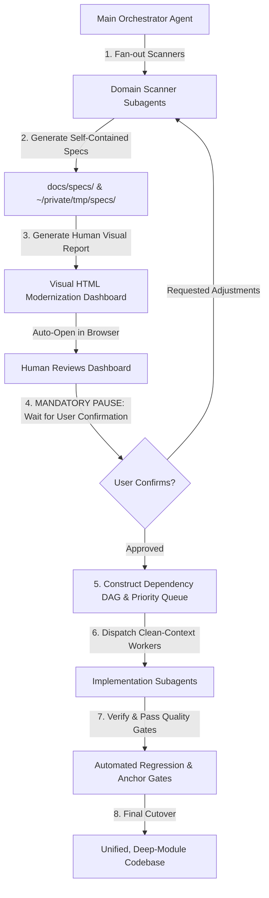
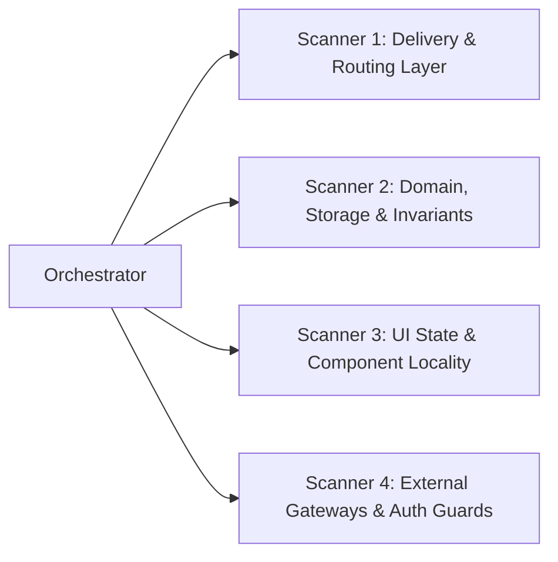
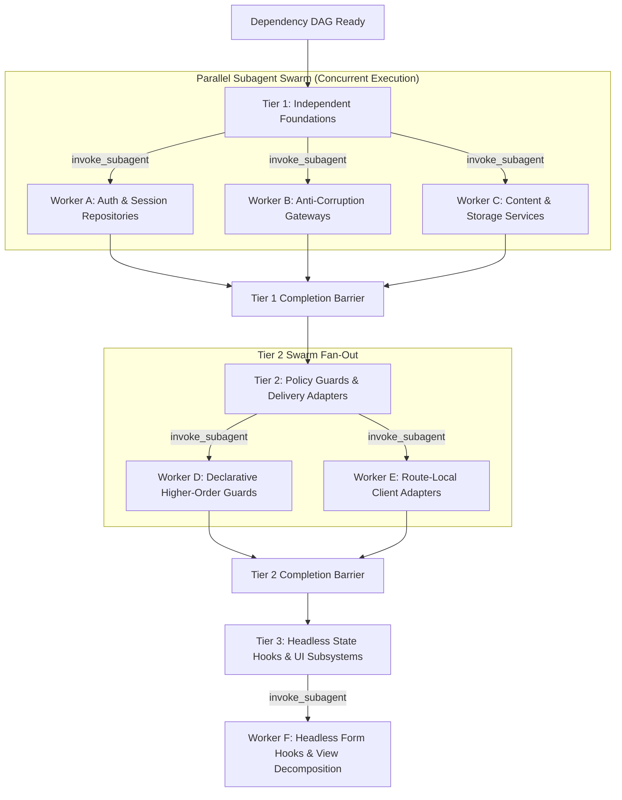

# Deforestation (/deforestation)

A systematic, multi-agent pipeline for dismantling legacy spaghetti codebases and rebuilding them with deep architectural seams in a single coordinated campaign.

Instead of an engineer or agent blindly making 20 iterative refactoring passes, `/deforestation` uses a **Scan-Specify-Review-Fanout** architecture:
1. **Context-Isolated Scanning**: Dedicated subagents scan subsystems concurrently without overflowing the orchestrator's context window.
2. **Authoritative Specification Generation**: Subagents draft rigorous, self-contained RFC/Spec documents saved to `~/private/tmp/{project-name}/specs/` and `docs/specs/`.
3. **Human-Facing Visual HTML Dashboard**: Compiles all findings into a rich, interactive HTML dashboard with Before/After diagrams and automatically opens it for the human.
4. **MANDATORY HUMAN CONFIRMATION GATE**: Pauses and waits for explicit user confirmation before modifying code.
5. **Fresh-Context Implementation Fan-out**: Clean-context subagents are dispatched with `[Spec + Overall Goal + greenfield-architecture Skill]` to implement each seam deterministically.



---

## Phase 1: Context-Isolated Codebase Scanning

The Orchestrator agent **MUST NOT** attempt to read the entire codebase into its primary context. Instead, it spawns specialized read-only subagents to audit distinct architectural slices:



### Scanner Assignments:
1. **Delivery & Routing Scanner**: Flags leaked storage queries, raw ORM calls in endpoints, and bloated routes (>30 lines).
2. **Domain, Storage & Invariant Scanner**: Flags shallow pass-through services, missing transactional cascades, and bypassed compliance/audit logging.
3. **UI State & Component Locality Scanner**: Flags monolithic components (>300 lines), excessive state variables (>3 hooks), raw browser alerts/reloads, and stranded single-route views.
4. **External Integrations & Security Scanner**: Flags scattered third-party API calls, unmasked PII, hardcoded secrets/GUIDs, and copy-pasted authorization boilerplate.

---

## Phase 2: Generating Specifications & Human-Facing HTML Dashboard

Documentation is generated for both **Agents** (executable specs) and **Humans** (clear visual dashboard):

### For Agents: Authoritative Self-Contained Specs
Each scanner writes structured Markdown specifications using `SPEC-TEMPLATE.md` and saves them to:
- `docs/specs/SPEC-<NUMBER>-<SLUG>.md`
- `~/private/tmp/{project-name}/specs/SPEC-<NUMBER>-<SLUG>.md`

### For Humans: Visual HTML Modernization Dashboard
The Orchestrator compiles all scanner findings into a single self-contained HTML dashboard (`~/private/tmp/{project-name}/deforestation-dashboard.html` or `/tmp/deforestation-<timestamp>.html`) and **automatically opens it in the user's browser**:

```bash
# Auto-open command executed by the agent:
open ~/private/tmp/{project-name}/deforestation-dashboard.html
```


### Plain English Writing Mandate for Human-Facing Dashboards:
When generating HTML reports for humans, **write in clear, simple, plain English**. Do NOT use unnecessary academic or overly dense jargon. Only use technical architectural terms when strictly necessary to reference a specific file, tool, type, or function.

#### Jargon vs. Plain English Guide:
| Jargon (Avoid in HTML Reports) | Plain English Translation (Use This) |
| :--- | :--- |
| "Leaky abstraction with direct persistence coupling" | "The web page talks directly to the database instead of using a dedicated data manager." |
| "Shotgun surgery across shallow adapters" | "Changes to one feature force us to edit 5 different files instead of just one." |
| "Monolithic presentation component with entangled state dispatch" | "One giant 600-line screen is handling visual layout, button clicks, data fetching, and error popups all at once." |
| "Enforce immutable provenance snapshots within transactional boundary" | "Automatically saves a revision history record whenever a post is updated so nothing is lost." |
| "Higher-order declarative policy interception" | "A single security check that automatically blocks non-admin users before running actions." |
| "Anti-corruption gateway isolating vendor telemetry payload serialization" | "A dedicated integration helper that formats data for HubSpot/Stripe so external changes don't break our app." |

#### Plain English Card Format:
- **What is the problem?** (1-2 simple sentences explaining what hurts or where bugs happen).
- **How are we fixing it?** (1-2 simple sentences explaining the clean new structure).
- **Why this helps:** (Short 3-5 word bullet points like "Bugs are fixed in one place", "Prevents unauthorized edits", "Cuts 400 lines of messy code").

#### What the HTML Dashboard Contains:
1. **Executive Scorecard**: Total files analyzed, tests passing, coverage, and total smells identified.
2. **Before vs. After Candidate Cards**:
   - **Problem & Solution**: 1-2 sentence plain-language diagnosis.
   - **Visual Diagrams**: Side-by-side Mermaid diagrams illustrating the current tightly coupled state vs. the target deep seam.
   - **Involved Files & Seams**: Clear list of old vs. new files.
   - **Recommendation Badges**: `Strong` (emerald), `Worth exploring` (amber), `Speculative` (slate).
3. **Stacked PR Execution Roadmap**: Interactive visual DAG showing the exact order of implementation.

---

## Phase 3: MANDATORY HUMAN CONFIRMATION GATE (STOP & WAIT)

> [!IMPORTANT]
> **STRICT EXECUTION GATE**: After scanning the codebase, generating the specifications, compiling the execution plan, and opening the HTML dashboard, the Orchestrator **MUST ALWAYS PAUSE AND WAIT FOR HUMAN CONFIRMATION**.
>
> **The Orchestrator MUST NOT launch implementation subagents or modify any code until the user explicitly responds with approval.**

### Prompt to the User:
The agent must end its turn with a clear invitation for review:
```text
I have completed the architectural scan of the codebase, generated detailed refactoring specifications, and opened the visual Modernization Dashboard in your browser:

📊 Modernization Dashboard: ~/private/tmp/{project-name}/deforestation-dashboard.html
📁 Specifications: ~/private/tmp/{project-name}/specs/

The dashboard details all identified architectural smells, proposed deep seams (with Before/After diagrams), and the planned stacked PR sequence.

Please review the proposed plan in your browser. Would you like to proceed with the refactoring campaign as outlined, or make any adjustments before implementation starts?
```

---

## Phase 4: Mandatory Subagent Swarm Fan-Out (Post-Confirmation)

> [!IMPORTANT]
> **MANDATORY SUBAGENT SWARM POLICY (NO SINGLE-AGENT BOTTLENECK)**:
> Whenever 2 or more refactoring specifications exist in the DAG, the Orchestrator **MUST DISPATCH A SWARM OF PARALLEL SUBAGENTS**.
>
> **FORBIDDEN**:
> - **DO NOT** attempt to implement all specs sequentially inside the main Orchestrator context. Doing so causes severe context exhaustion, hallucinated edits, and high latency.
> - **DO NOT** run E2E or full test suites in a loop before dispatching workers.
>
> **MANDATED ACTION**:
> 1. Partition independent specs in the current DAG tier across distinct subsystems.
> 2. Call `invoke_subagent` with multiple parallel subagent definitions in a single call to launch the implementation swarm concurrently.
> 3. Keep the Orchestrator context lightweight strictly for coordination, DAG state tracking, and final verification.



---

### Swarm Partitioning & Anti-Collision Rules:
1. **Subsystem Isolation**: Assign each subagent in the swarm to an isolated subsystem directory (e.g., Worker 1 touches `src/lib/auth/`, Worker 2 touches `src/lib/gateway/`, Worker 3 touches `src/app/admin/users/`).
2. **Zero Overlap**: Never assign two concurrent workers to edit the same file simultaneously.
3. **Batch Launching**: Dispatch all unblocked nodes in the current tier simultaneously via `invoke_subagent` (typically 2–5 parallel workers per tier).

---

### The Subagent Prompt Contract:
For every worker in the swarm, the Orchestrator supplies this self-contained prompt:

```text
You are an expert software engineer executing an isolated architectural refactoring task in the /deforestation swarm.

1. OVERALL CODEBASE GOAL: [Brief summary of project vision and architecture standards]
2. ARCHITECTURAL SKILL REFERENCE: Consult the "greenfield-architecture" skill for deep-module design patterns.
3. YOUR SPECIFICATION: Read and execute `docs/specs/SPEC-<ID>-<NAME>.md` (or `~/private/tmp/{project-name}/specs/`).

INSTRUCTIONS:
- Follow the Step-by-Step Implementation Plan in your assigned spec exactly.
- Build the deep module, encapsulate all listed invariants, and keep adapters thin (<30 lines).
- Write comprehensive unit tests for all new modules in your subsystem.
- Verify that your local test suite passes with 0 regressions.
- Report back with a concise summary of created files, refactored seams, and passing test results.
```

---

### Swarm Coordination & Reactive Progression:
1. After calling `invoke_subagent` to launch the tier's worker swarm, the Orchestrator **stops calling tools** and waits for the background subagent completion notifications.
2. As workers report back, the Orchestrator marks nodes in the DAG as complete.
3. When all dependencies for the next tier are satisfied, the Orchestrator dispatches the next subagent swarm.

---

## Phase 5: Verification, Quality Gate & Cutover

As implementation subagents complete their tasks:
1. **Deterministic Test Pass**: 100% test pass rate across all suites.
2. **Anchor Truth Assertion**: Verify Zero-Storage in delivery routes and zero circular dependencies.
3. **Dead Code Elimination**: Delete all replaced shallow adapters and legacy utility files.
4. **Final Delivery Report**: Update the visual HTML dashboard with the final green status and present the clean, un-spaghettied codebase.
