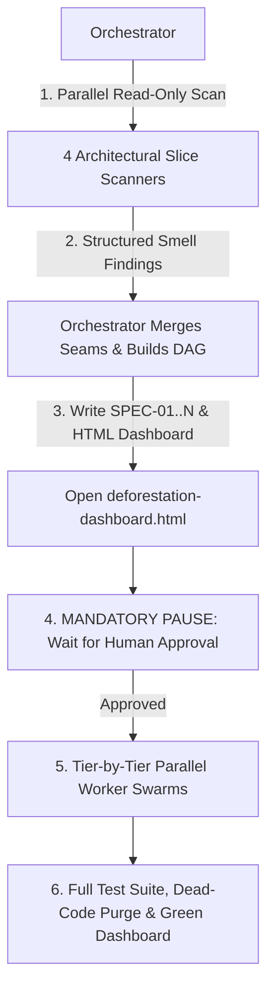

# Deforestation (`/deforestation`)

Dismantle legacy spaghetti codebases and rebuild them around deep architectural seams in a single coordinated campaign using **Scan -> Synthesize -> Review -> Swarm Fan-Out**.

Read [`../greenfield-architecture/PILLARS.md`](../greenfield-architecture/PILLARS.md) for the **8 Pillars** and [`../greenfield-architecture/DASHBOARD-STYLE.md`](../greenfield-architecture/DASHBOARD-STYLE.md) for HTML dashboard formatting.



---

## Phase 1: Context-Isolated Codebase Scanning

Keep the Orchestrator's context window clean by delegating discovery to 4 concurrent read-only `research` subagents (`invoke_subagent` in a single call). Each scanner audits one architectural slice against [`PILLARS.md`](../greenfield-architecture/PILLARS.md):

| Scanner | Architectural Slice | Target Smells to Flag |
| :--- | :--- | :--- |
| **Scanner 1** | Delivery & Routing Layer | Storage/ORM queries inside routes, controllers, or server actions; bloated adapters (>30 lines). |
| **Scanner 2** | Domain, Storage & Invariants | Shallow pass-through services, missing atomic transaction cascades, bypassed audit/revision rules. |
| **Scanner 3** | UI State & Locality | Monolithic views (>300 lines), >3 raw state hooks, blocking `alert()`/reloads, single-route views in global folders, missing subsystem barrels. |
| **Scanner 4** | External Gateways & Auth Guards | Raw `fetch`/vendor SDK calls outside gateways, unmasked PII/secrets, copy-pasted imperative role/tenant checks. |

### Scanner Output Contract
Instruct each scanner to return a concise structured report (without modifying files):
- **Baseline Metrics**: Files scanned, existing test runner command, current pass/coverage state.
- **Findings List**: Exact `file:startLine-endLine`, violated Pillar (`Pillar 1..8`), plain-English problem statement, and proposed target seam/module.

---

## Phase 2: Spec Synthesis, Dependency DAG & Visual Dashboard

Once all 4 scanners report back, set `PROJECT_NAME` (`basename "$(git rev-parse --show-toplevel 2>/dev/null || pwd)"`) and `OUT_DIR="$HOME/private/tmp/${PROJECT_NAME}"`.

### 1. Deduplicate & Assign Sequential Specs
Cross-layer findings often describe two ends of the same seam (e.g., Scanner 1 flags a route calling the DB directly; Scanner 2 flags the missing repository method).
1. **Merge** related findings into unified, vertical subsystem seams with **strictly disjoint file write scopes** within each execution tier.
2. **Assign sequential IDs** (`SPEC-01`, `SPEC-02`, ...) ordered into a Dependency DAG:
   - **Tier 1**: Foundational Deep Domain Repositories & Anti-Corruption Gateways.
   - **Tier 2**: Declarative Policy Guards & Thin Delivery Adapters.
   - **Tier 3**: Headless State Models, UI Decomposition & Locality Barrels.
3. **Write Authoritative Specs**: Save each specification using [`SPEC-TEMPLATE.md`](SPEC-TEMPLATE.md) to `docs/specs/SPEC-<NUMBER>-<SLUG>.md` and `${OUT_DIR}/specs/SPEC-<NUMBER>-<SLUG>.md`.

### 2. Render & Auto-Open `deforestation-dashboard.html`
Compile the modernization plan into `${OUT_DIR}/deforestation-dashboard.html` following [`../greenfield-architecture/DASHBOARD-STYLE.md`](../greenfield-architecture/DASHBOARD-STYLE.md):
- **Executive Scorecard**: Files analyzed, current test status, total smells found, and planned spec count.
- **Before vs. After Seam Cards**: Plain-English *Problem / Fix / Why* copy, side-by-side `<pre class="mermaid">` diagrams, owned file lists, and priority badges (`Strong`, `Worth exploring`, `Speculative`).
- **Tiered Swarm Execution DAG**: Visual diagram showing which specs run in parallel in Tier 1, Tier 2, and Tier 3.

Open the dashboard automatically:
```bash
open "${OUT_DIR}/deforestation-dashboard.html"
```

---

## Phase 3: Human Confirmation Gate (**Stop & Wait**)

> [!IMPORTANT]
> **MANDATORY PAUSE GATE**: After generating `docs/specs/SPEC-*.md` and opening `deforestation-dashboard.html`, end your turn and wait for explicit user approval before dispatching implementation workers or editing source code.

Present this summary and stop:
```text
I have scanned the codebase across all 8 Pillars, synthesized the refactoring specifications, and opened the Modernization Dashboard in your browser:

- Modernization Dashboard: ~/private/tmp/{project-name}/deforestation-dashboard.html
- Specifications: docs/specs/ (and ~/private/tmp/{project-name}/specs/)

Please review the Before/After seams and the tiered execution DAG. Reply "Proceed" to launch the implementation swarm, or share any adjustments first.
```

---

## Phase 4: Tiered Subagent Swarm Fan-Out (Post-Confirmation)

Upon user approval, execute the Dependency DAG tier by tier. Whenever a tier contains 2 or more specs, launch them **concurrently in a single `invoke_subagent` call** using write-capable `self` subagents.

### Anti-Collision Rules
1. **Disjoint Write Scopes**: Verify that no two concurrent workers in the same tier modify the same file (check `Owned Files` in each spec). If two specs touch a shared barrel or router file, either place one in the next tier or update the shared barrel at the Orchestrator barrier.
2. **Reactive Barrier**: After calling `invoke_subagent` for the active tier, stop calling tools and wait for all workers in that tier to complete before launching the next tier.

### Worker Subagent Prompt Contract
Supply each worker with this self-contained prompt:
```text
You are an implementation worker in the /deforestation swarm executing SPEC-<ID>.

1. ARCHITECTURAL LAWS: Read `~/.gemini/config/skills/greenfield-architecture/PILLARS.md`.
2. ASSIGNED SPECIFICATION: Read and execute `docs/specs/SPEC-<ID>-<SLUG>.md`.
3. EXCLUSIVE FILE SCOPE: Only create or modify the files listed under "Owned Files" in your spec.

EXECUTION STEPS:
1. Scaffold the deep module, gateway, guard, or headless model with strict types and public interface.
2. Encapsulate all invariants, transactions, and error handling defined in the spec.
3. Write unit and invariant tests exercising the public interface (target >=85% branch/statement coverage).
4. Refactor the assigned callers into thin adapters (<30 lines) and remove dead local helpers.
5. Run the targeted test suite and typechecker for your subsystem until 100% GREEN.
6. Reply with: created/modified files, public seam signature, and test runner output.
```

---

## Phase 5: Cutover, Anchor Verification & Final Dashboard

After the final tier completes:
1. **Full Repository Verification**: Run the complete test suite, typechecker, and build command once at the repository root.
2. **Anchor Truth Check**: Verify zero direct storage imports in delivery routes and zero circular dependencies.
3. **Dead Code Purge**: Delete any remaining deprecated adapters or unused legacy utilities replaced by the new seams.
4. **Update Dashboard**: Refresh `${OUT_DIR}/deforestation-dashboard.html` with `COMPLETED / GREEN` badges and final test metrics.
