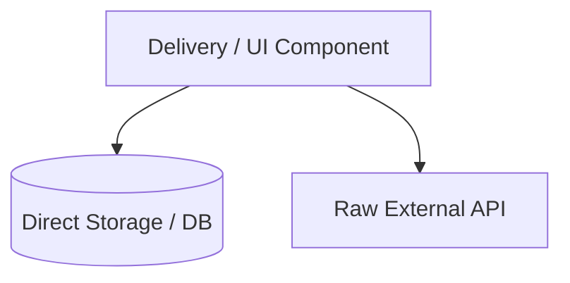
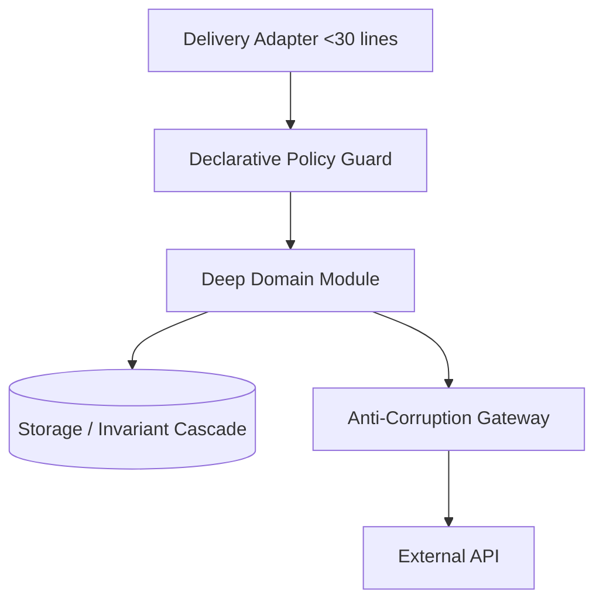

# Architectural Specification: [SPEC-ID] - [Subsystem / Seam Name]

## 1. Executive Summary & Objective
- **Target Subsystem**: [e.g., Content Management, User Authentication, External CRM Integration]
- **Primary Objective**: [Brief description of the deep seam to be established and the architectural smells to eliminate]
- **Target Seam Depth**: [High / Medium]
- **Dependencies**: [List any prerequisite specs that must be completed first, or `None`]

---

## 2. Current State & Architectural Friction (Before)
- **Involved Files**:
  - `path/to/existing/file1.ts` (Lines X-Y)
  - `path/to/existing/file2.ts` (Lines A-B)
- **Smells Identified**:
  - [ ] Leaked storage / DB queries inside delivery adapters
  - [ ] Monolithic UI component mixing state, validation, and presentation (>300 lines)
  - [ ] Imperative copy-pasted authorization checks
  - [ ] Missing anti-corruption layer for external third-party API
  - [ ] Bypassed compliance / audit / revision invariants
  - [ ] Single-route component stranded in global directory
- **Before Architecture Diagram**:


---

## 3. Target Architecture & Deep Seam Interface (After)
- **New / Refactored Modules**:
  - `path/to/deep/module.ts` (Encapsulated Domain Repository / Gateway / Headless Hook)
  - `path/to/adapter.ts` (Thin Delivery Adapter, <30 lines)
- **Public Interface Contract**:
```typescript
export interface TargetInterface {
  // Define strict public signatures hiding internal complexity
  executeOperation(input: InputDTO, actor: ActorContext): Promise<ResultDTO>;
}
```
- **Encapsulated Invariants**:
  - [List all compliance, audit, versioning, and validation logic hidden inside this module]
- **After Architecture Diagram**:


---

## 4. Step-by-Step Implementation Plan
1. **Scaffold Deep Module & Interface**: Create the domain repository / gateway / hook with full type signatures.
2. **Encapsulate Invariants & Business Logic**: Migrate queries, serialization, audit logs, and validation into the deep module.
3. **Write Unit Tests & Deterministic Mocks**: Implement comprehensive test suites asserting all invariants and edge cases.
4. **Refactor Delivery Callers**: Replace raw calls in routes/actions/views with thin invocations of the deep module.
5. **Enforce Locality & Barrels**: Move route-local views to route folders; export shared subsystems via `index.ts`.
6. **Purge Dead Legacy Code**: Remove bypassed utility files, redundant state hooks, and deprecated aliases.

---

## 5. Deterministic Verification & Quality Gate
- **Required Tests**:
  - Unit test suite: `path/to/module.test.ts` (Asserting 100% invariant coverage)
  - Architecture assertion: Zero direct storage imports in delivery files
  - Branch & Statement Coverage Bar: >=85%
- **Regression Checklist**:
  - [ ] All existing test suites pass without regression
  - [ ] Typechecker passes with 0 errors
  - [ ] Build completes with 0 warnings / deprecation notices
