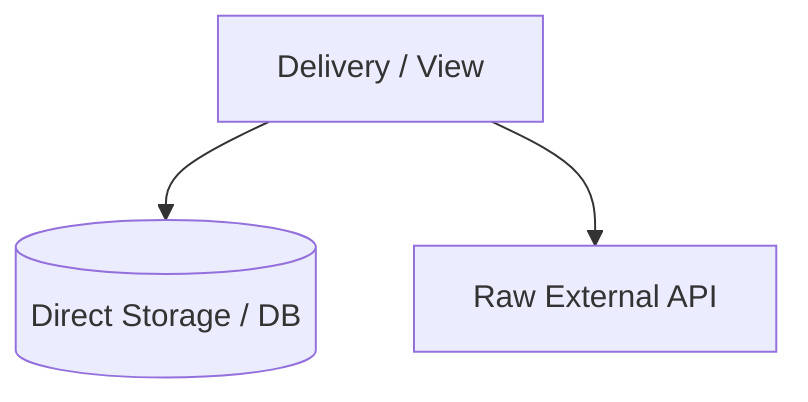
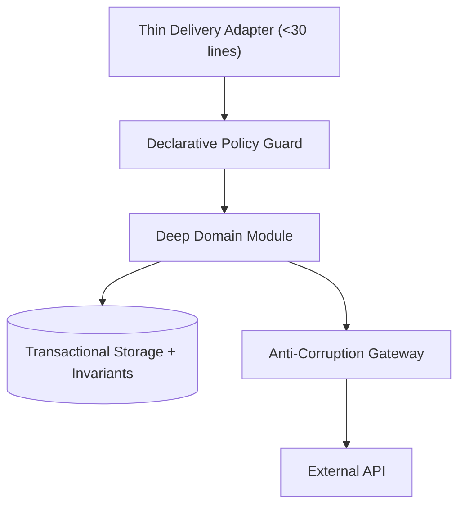

# Architectural Specification: [SPEC-ID] — [Subsystem / Seam Name]

## 1. Metadata & Execution Scope
- **Target Subsystem**: [e.g., Content Management, User Auth, External Billing Gateway]
- **Violated Pillars**: [e.g., Pillar 2 (Invariants), Pillar 3 (External Boundaries)]
- **DAG Tier & Dependencies**: `Tier [1 | 2 | 3]` — Depends on: `[None | SPEC-XX]`
- **Owned Files (Exclusive Write Scope for Assigned Worker)**:
  - **Create / Deepen**: `path/to/deep/module.ts`, `path/to/deep/module.test.ts`
  - **Thin Callers**: `path/to/delivery/adapter.ts`
  - **Delete**: `path/to/legacy/helper.ts`

---

## 2. Current State & Architectural Friction (Before)
- **Source Locations**:
  - `path/to/existing/file1.ts#L10-L120` — [Brief description of smell]
  - `path/to/existing/file2.ts#L45-L90` — [Brief description of smell]
- **Smells Identified**:
  - [ ] Direct storage / ORM queries inside delivery adapter
  - [ ] Monolithic UI view mixing layout, state hooks, and side effects (>300 lines)
  - [ ] Copy-pasted imperative role/tenancy checks
  - [ ] Raw third-party API / SDK calls without an Anti-Corruption Gateway
  - [ ] State mutation bypassing transactional audit / revision invariants
  - [ ] Single-consumer file stranded in global folder or missing subsystem barrel
- **Before Diagram**:


---

## 3. Target Deep Seam & Interface Contract (After)
- **Public Interface Signature**:
```typescript
export interface TargetModule {
  // Small, high-leverage interface hiding internal complexity
  executeOperation(input: InputDTO, actor: ActorContext): Promise<ResultDTO>;
}
```
- **Encapsulated Invariants**:
  - [List validation, atomic transaction cascades, audit logging, retry/fallback, or state rules hidden inside the module]
- **After Diagram**:


---

## 4. Step-by-Step Implementation Plan
1. **Scaffold Deep Module & Types**: Create the module, interface, and in-memory test fake (if gateway) in the target subsystem directory.
2. **Encapsulate Invariants**: Move storage queries, transactional cascades, audit/revision writes, and vendor translation inside the module.
3. **Write Unit & Invariant Tests**: Test happy paths, boundary conditions, and error/permission rejections through the public interface.
4. **Thin the Callers**: Replace inline logic in `Owned Files` callers with a single call through the guard and deep module (<30 lines).
5. **Enforce Locality & Barrels**: Co-locate single-route files and export shared module interfaces via the subsystem barrel (`index.ts` / package root).
6. **Delete Obsolete Code**: Remove the replaced legacy helpers listed in `Owned Files`.

---

## 5. Completion Criteria & Quality Gate
- [ ] Targeted unit & invariant test suite (`path/to/deep/module.test.ts`) passes (`GREEN`) with $\ge 85\%$ statement/branch coverage.
- [ ] Delivery adapters in `Owned Files` contain zero direct database/SDK imports and are $<30$ lines.
- [ ] Typechecker and linter pass with zero errors across modified files.
