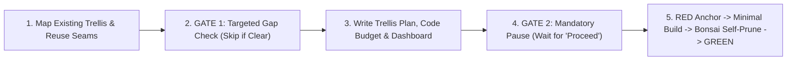

# Espalier (`/espalier`)

Train small, specific features to grow neatly along your codebase's existing architectural rails ("the trellis"). Combines the upfront planning and **8-Pillar** seam discipline of `greenfield-architecture` with the minimal-code, zero-bloat philosophy of `/bonsai`—adding only the minimum code required and accessing other features strictly through public barrels only when needed to prevent duplication.

Read [`TRELLIS-RULES.md`](TRELLIS-RULES.md) for the **5 Espalier Laws** and Trellis Plan template, [`../greenfield-architecture/PILLARS.md`](../greenfield-architecture/PILLARS.md) for the **8 Pillars**, [`../bonsai/PRUNING-PATTERNS.md`](../bonsai/PRUNING-PATTERNS.md) for the **5 Pruning Shears**, and [`../greenfield-architecture/DASHBOARD-STYLE.md`](../greenfield-architecture/DASHBOARD-STYLE.md) for HTML dashboard formatting.



---

## Phase 1: Existing Trellis Audit & Targeted Gap Check (**Gate 1 — Only If Ambiguous**)

1. **Map the Existing Trellis First**:
   - Inspect the target subsystem, existing domain repositories, policy guards, external gateways, headless state models, and `package.json`.
   - **Shared Context Check (When Present — Optional)**: If `GLOSSARY.md`, `AGENTS.md`, or `docs/specs/` exist in the repository, adopt their canonical domain and seam names so the feature uses the project's shared vocabulary. (`/espalier` runs 100% standalone when these files are absent.)
   - **Reuse-Before-Build Inventory**: Identify every existing public barrel that already handles auth, validation, data access, or formatting for this domain so zero logic is duplicated.
2. **Identify Only Relevant Pillar Gaps**:
   - Evaluate only the **8 Pillars** touched by this small feature (e.g., new fields/types, invariant or transaction rule, existing policy guard to reuse, external gateway impact, or UI state change).
   - **Gate 1 Completion Criterion**: If all requirements are clear from the user's prompt and codebase, proceed directly to Phase 2. If genuine business-rule ambiguity remains, ask 1–3 concise clarifying questions (proposing minimal-code defaults) and end your turn to wait for answers.

---

## Phase 2: The Trellis Plan, Code Budget & Visual Dashboard

Set `PROJECT_NAME` (`basename "$(git rev-parse --show-toplevel 2>/dev/null || pwd)"`) and `OUT_DIR="$HOME/private/tmp/${PROJECT_NAME}"`.

1. **Write the Compact Trellis Plan (`${OUT_DIR}/espalier-plan.md`)**:
   - Populate the template in [`TRELLIS-RULES.md`](TRELLIS-RULES.md) documenting:
     - **Acceptance Criteria**: 2–5 checkable `Given / When / Then` statements.
     - **Existing Trellis Reuse & Cross-Feature Access Map**: Every existing public barrel reused or extended, proving why each cross-feature touch prevents duplication (zero deep internal imports).
     - **Minimal Touch-List & Code Budget**: Exact files to edit/create, estimated net LOC per file, and **Zero Heavy Dependencies** (native APIs or `<10KB` internal helpers over new packages).
2. **Render & Auto-Open `espalier-dashboard.html`**:
   - Compile the plan into `${OUT_DIR}/espalier-dashboard.html` following [`../greenfield-architecture/DASHBOARD-STYLE.md`](../greenfield-architecture/DASHBOARD-STYLE.md) (plain English, zero academic jargon, live Mermaid ESM script):
     - **Trellis Scorecard**: Planned files touched, estimated net LOC budget, existing seams reused, new dependencies (`0`), and acceptance criteria count.
     - **Trained Growth Diagram (`<pre class="mermaid">`)**: Visual diagram distinguishing *Existing Seams Reused* vs. *Minimal New Branch Added* (showing barrel-only cross-feature links).
     - **Plain-English Scope & Reuse Cards**: *What are we adding?*, *What existing parts are we reusing instead of duplicating?*, and *How we keep the change tiny and safe*.
   - Open the dashboard automatically:
     ```bash
     open "${OUT_DIR}/espalier-dashboard.html"
     ```

---

## Phase 3: Trellis Plan Confirmation (**Gate 2 — Mandatory Pause**)

> [!IMPORTANT]
> **MANDATORY PAUSE GATE**: After writing `${OUT_DIR}/espalier-plan.md` and opening `espalier-dashboard.html`, end your turn and wait for explicit human confirmation before creating or editing any production source or test files.

Present this summary and stop:
```text
I have mapped the existing seams to reuse, drafted the minimal-code Trellis Plan, and opened the Espalier Dashboard in your browser:

- Dashboard: ~/private/tmp/{project-name}/espalier-dashboard.html
- Trellis Plan & Code Budget: ~/private/tmp/{project-name}/espalier-plan.md
- Planned Footprint: <N> files touched (~<LOC> net lines, <M> existing seams reused, 0 new heavy libraries)

Please review the touch-list and reuse boundaries. Reply "Proceed" to build and self-prune the feature, or share any adjustments first.
```

---

## Phase 4: Trained Construction & Bonsai Self-Prune (Post-Confirmation)

Once the human approves, implement the feature strictly inside the approved Touch-List:

1. **Write Failing Anchor Tests (`RED`)**:
   - Add concise, deterministic tests at the module's public interface covering every `Given / When / Then` acceptance criterion (happy path, edge cases, and policy/invariant rejections) and observe `RED`.
2. **Implement Minimal Trained Growth**:
   - Extend the existing deep module or add the minimal new module directly on the approved 5-Tier seam, keeping delivery adapters `<30 lines`.
   - Reuse existing public barrels for cross-feature capabilities; keep internal files of other features untouched.
   - Apply `/bonsai` expression conciseness from line 1: flat early-return guard clauses, lookup maps, declarative pipelines, native runtime primitives, and zero speculative abstractions (`YAGNI`).
3. **Verify `GREEN` & Run the Bonsai Self-Prune Pass**:
   - Run the targeted and full test suites, typechecker, and linter until `100% GREEN`.
   - Inspect `git diff` against the **5 Pruning Shears** ([`../bonsai/PRUNING-PATTERNS.md`](../bonsai/PRUNING-PATTERNS.md)): compress any verbose 12-line block into 3 clear lines, inline any single-caller wrapper you introduced, and confirm zero dead code or duplicated logic remains.
   - Re-verify `100% GREEN` after any self-prune polish.

---

## Phase 5: Footprint Proof & Green Dashboard

1. **Audit Final Footprint Against Budget**:
   - Run `git diff --stat` and confirm every modified file stays within the approved Touch-List, cross-feature access uses public barrels only with zero circular imports, and zero heavy third-party packages were added.
2. **Update Dashboard & Present Summary**:
   - Refresh `${OUT_DIR}/espalier-dashboard.html` with `COMPLETED / GREEN` status, actual `git diff --stat` LOC vs. planned budget, and test pass output.
   - If `GLOSSARY.md` exists and a new canonical domain term or seam was introduced, update `GLOSSARY.md` to stay in sync.
