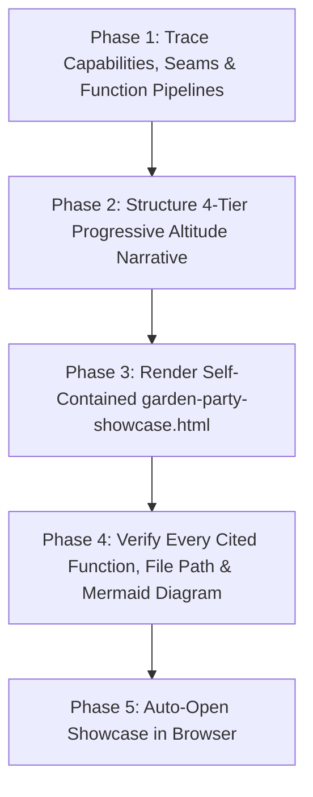

# Garden Party (`/garden-party`)

Dress up the codebase for a mixed-audience tour: generate a self-contained, single-page HTML showcase (`garden-party-showcase.html`) structured as a **4-Tier Progressive Altitude Scroll**. Business executives get a crystal-clear, jargon-free overview in the top third of the page, while curious product leads and engineers can scroll deeper through system architecture diagrams all the way down to exact function-level **`Input → Processing → Output`** data-flow traces.

Read [`SHOWCASE-TEMPLATE.md`](SHOWCASE-TEMPLATE.md) for the 4-Tier progressive scroll layout and `Input → Processing → Output` trace specification, [`../greenfield-architecture/PILLARS.md`](../greenfield-architecture/PILLARS.md) for the **8 Pillars & 5-Tier Seam Taxonomy**, and [`../greenfield-architecture/DASHBOARD-STYLE.md`](../greenfield-architecture/DASHBOARD-STYLE.md) for plain-English and Mermaid rendering rules.



---

## Phase 1: Codebase & Data-Flow Discovery

1. **Shared Context Check (When Present — Optional)**:
   - Check whether `GLOSSARY.md`, `README.md`, `AGENTS.md`, or `docs/specs/` (`ARCHITECTURE-SPEC.md`, `SPEC-*.md`) exist in the repository. When present, adopt their canonical domain vocabulary and documented 5-Tier seam names so the showcase reinforces the project's shared language. (`/garden-party` never requires these files and runs 100% standalone when they are absent.)
2. **Choose Scan Mode by Repository Size**:
   - **Small / Medium Repo (<50 source files)**: Inspect entrypoints, routes/controllers/CLI commands, domain modules/repositories, external gateways, state models, and tests directly.
   - **Large / Multi-Subsystem Repo**: Spawn 2–3 concurrent read-only `research` subagents (`invoke_subagent` in a single call) to trace:
     1. **Business Capability & Entrypoint Scanner**: Public routes, UI views, CLI commands, background jobs, and user-facing workflows.
     2. **Architecture & External Boundary Scanner**: Domain subsystems, database schemas/repositories (Pillar 2), policy guards (Pillar 4), external vendor gateways (Pillar 3), and headless state models (Pillar 5).
     3. **Deep Pipeline Tracer (`Input → Processing → Output`)**: For the top 3–6 core workflows in the codebase, trace the exact function call chain from entry adapter (`file:line`) through guard validation, domain processing/transactions, and gateway calls to the final output payload.

---

## Phase 2: Build the 4-Tier Progressive Altitude Narrative

Organize the discovered facts into the 4 progressive scroll tiers defined in [`SHOWCASE-TEMPLATE.md`](SHOWCASE-TEMPLATE.md):

1. **Tier 1 — The Lawn (`Top 1/3`: Executive & Business Overview — 0% Code/Jargon)**:
   - **Plain-English Mission Statement**: Explain in 2–3 sentences what the system does, who uses it, and what business value it delivers.
   - **Business Value & Trust KPI Cards**: Highlight core capabilities delivered, automated security/compliance guardrails, external partner integrations, and automated quality verification.
   - **Ecosystem Overview Diagram (`<pre class="mermaid">`)**: High-level business flowchart showing users/actors, the product, and connected partner platforms in plain English.
2. **Tier 2 — The Garden Pathways (`Upper-Mid`: Core Capabilities & User Journeys)**:
   - **Capability Cards**: Present each major feature using three plain-English prompts:
     - *What triggers it?* (The customer or staff action).
     - *What happens automatically behind the scenes?* (Business rules, security checks, and safeguards).
     - *What is the guaranteed result?* (The business outcome).
   - **User Journey Flowcharts (`<pre class="mermaid">`)**: Step-by-step visual journeys showing how requests move from start to finish in plain language.
3. **Tier 3 — The Greenhouse (`Lower-Mid`: System Architecture & 5-Tier Seams)**:
   - **5-Tier Deep Seam Architecture Diagram (`<pre class="mermaid">`)**: Visual map of the system's **Thin Delivery Adapters**, **Declarative Policy Guards**, **Deep Domain Modules / Repositories**, **Anti-Corruption Gateways**, and **Headless State Models**.
   - **Subsystem & Boundary Matrix**: Scannable table mapping each subsystem (`src/...`) to its canonical name, 5-Tier Seam role, owned data entities, and external integrations.
4. **Tier 4 — The Root System (`Bottom 1/3`: Function-Level `Input → Processing → Output` Traces)**:
   - For each core workflow (3–6 end-to-end pipelines), build a deep technical trace card containing:
     - **Function-Level Mermaid Sequence or Data-Flow Diagram**: Tracing exact function calls (`Adapter -> Guard -> Repository.method() -> Gateway.call() -> Output DTO`).
     - **3-Column `Input → Processing → Output` Breakdown**:
       - **📥 Input**: Exact entry file/function (`file:line`), incoming payload type/fields, and policy guard checks.
       - **⚙️ Processing**: Exact domain/repository functions (`file:line`), data transformations, invariant validations, atomic DB transaction cascades, and external gateway calls.
       - **📤 Output**: Exact return type/envelope, persisted records/events, cache updates, and typed error modes.
     - **Collapsible Code & Signature Inspector (`<details>`)**: Real function signatures and key implementation snippets from the codebase.

---

## Phase 3: Render Self-Contained `garden-party-showcase.html`

Set `PROJECT_NAME` (`basename "$(git rev-parse --show-toplevel 2>/dev/null || pwd)"`) and `OUT_DIR="$HOME/private/tmp/${PROJECT_NAME}"`.

Compile the 4-Tier progressive showcase into `${OUT_DIR}/garden-party-showcase.html` following [`SHOWCASE-TEMPLATE.md`](SHOWCASE-TEMPLATE.md) and [`../greenfield-architecture/DASHBOARD-STYLE.md`](../greenfield-architecture/DASHBOARD-STYLE.md):
- Include the **Sticky Progressive-Depth Navigation Bar** at the top so readers can jump directly to *1. The Lawn*, *2. The Pathways*, *3. The Greenhouse*, or *4. The Roots*.
- Include visual altitude divider banners between each tier signaling the shift in depth as the reader scrolls down.
- Load Tailwind CSS and Mermaid v11 ESM in `<head>` so every diagram renders live from disk with zero build step.

---

## Phase 4: Ground-Truth Verification

Before opening the showcase, verify three deterministic quality checks:
1. **Zero Hallucinated Functions or Paths**: Confirm that every file path and function name cited in Tier 3 and Tier 4 exists in the repository (`0` phantom files or invented functions).
2. **Altitude Discipline Check**: Confirm Tier 1 (`#tier-1-lawn`) contains zero raw file paths, code blocks, or unexplained technical acronyms.
3. **Mermaid Syntax Check**: Confirm all `<pre class="mermaid">` blocks quote node labels containing parentheses, colons, arrows, or slashes so every diagram renders cleanly without syntax errors.

---

## Phase 5: Auto-Open Showcase & Present Summary

Automatically open the showcase in the user's browser:
```bash
open "${OUT_DIR}/garden-party-showcase.html"
```

Conclude with a concise tour summary telling the human where the file lives (`~/private/tmp/{project-name}/garden-party-showcase.html`) and highlighting which workflows are traced across the 4 scroll tiers.
