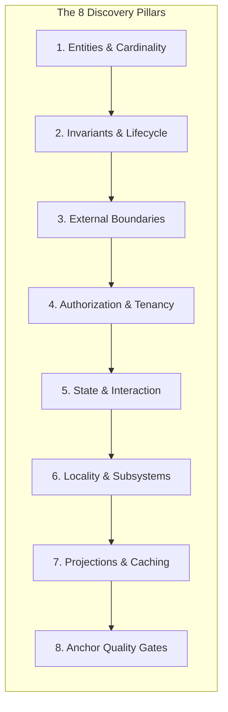

# Greenfield Architecture & Upfront Discovery (Day-1 Rigor)

Build software correctly from Day 1 without iterative multi-cycle refactoring loops. This skill guides the agent to:
1. **Exhaustively interrogate the human upfront** across the 8 architectural pillars.
2. Decompose high-level architecture into **concrete User Stories with Acceptance Criteria and GitHub Issues**.
3. Publish tracking artifacts to `~/private/tmp/{project-name}` or GitHub.
4. **Render and automatically open a visual HTML architecture dashboard** for the human.
5. **PAUSE FOR EXPLICIT HUMAN CONFIRMATION** before writing a single line of production code.
6. Construct the codebase using universal deep-module design principles and deterministic anchor truth tests.

---

## 1. The 8-Pillar Upfront Human Interrogation Protocol

Before writing code or scaffold files, you **MUST** interrogate the human across the 8 architectural pillars. Do not assume or guess ambiguous requirements. Ask explicit, structured questions to gain a complete understanding of the final state.



### Pillar 1: Domain Entities, Relationships & Cardinality
- What are all the core domain entities in the system, and what is their relational cardinality (1:1, 1:N, N:M)?
- Are there hierarchical, recursive, or polymorphic relationships (e.g., nested categories, composite trees, multi-type resources)?
- What composite views, summary rollups, or aggregate projections will the delivery layer require?

### Pillar 2: Invariants, Compliance & Lifecycle Transitions
- What regulatory, business, or operational constraints are non-negotiable (e.g., immutable audit logging, revision history, legal retention, soft deletion)?
- What are the valid lifecycle state transitions (e.g., `draft` -> `pending_review` -> `published` -> `archived`), and what conditions/actors permit each transition?
- Which state mutations require atomic relational cascades (e.g., creating child records, updating search indexes, invalidating caches) in a single transactional boundary?

### Pillar 3: External Boundaries & Anti-Corruption Layers
- What third-party services, APIs, databases, or message buses will the system interact with?
- What are the required fallback, retry, and offline behaviors if an external dependency fails (e.g., local queuing, fallback storage, mock test drivers)?
- What sensitive data (PII, tokens, secrets) must be sanitized or masked before crossing system boundaries?

### Pillar 4: Authorization, Actors & Policy Gating
- What actor types and permission roles exist (e.g., Anonymous, Standard User, Editor, Administrator, System Worker)?
- What are the tenancy boundaries (e.g., single-tenant, multi-tenant workspace, geographic compliance boundaries)?
- How should authorization violations and authentication challenges be communicated to callers (e.g., typed error envelopes, redirect flows, audit security alerts)?

### Pillar 5: User Interaction, Form State & Mutations
- What multi-step workflows, wizards, or complex input forms exist?
- How should form validation, dirty tracking, optimistic updates, and submission feedback be orchestrated?
- What interactive client behaviors are needed (e.g., ranked search, faceted filtering, table sorting, autosave)?

### Pillar 6: Code Locality, Subsystem Grouping & Boundaries
- Which components, views, or handlers are strictly single-consumer (local to one route or endpoint) versus shared across multiple consumers?
- How should shared capabilities be grouped into cohesive domain subsystems with explicit public barrel facades?

### Pillar 7: Query Projections, Performance & Caching
- What are the critical high-traffic read paths, and how can composite projections be structured to eliminate N+1 query patterns?
- Where do caching boundaries belong (e.g., edge, memory, distributed store, HTTP cache-control)?

### Pillar 8: Quality Gates & Deterministic Anchor Truths
- What hard architectural invariants must be asserted via automated tests (e.g., zero direct storage/database imports in delivery routes, zero circular dependencies, mandatory statement/branch coverage thresholds)?
- What end-to-end integration journeys define a successful implementation?

---

## 2. Specification Decomposition & Publishing Pipeline

Once discovery is complete, the agent creates documentation tailored for both **Agents** (executable specs) and **Humans** (clear visual dashboards).

```mermaid
graph TD
    Interrogate[8-Pillar Interrogation] --> ArchSpec[1. System Architecture Specification]
    ArchSpec --> UserStories[2. Decompose into User Stories & Acceptance Criteria]
    UserStories --> Issues[3. Generate GitHub Issues / Markdown Tickets]
    Issues --> Publish[4. Publish Artifacts to ~/private/tmp/{project-name} & GitHub]
    Publish --> HTML[5. Generate & Open Visual HTML Architecture Dashboard]
    HTML --> Pause["6. MANDATORY PAUSE: Wait for User Confirmation"]
    Pause -->|User Approves| Implement[7. Greenfield Implementation Fan-Out]
    Pause -->|User Requests Changes| Adjust[Adjust Specifications & Dashboard]
    Adjust --> HTML
```

### Step 1: System Architecture Specification
Synthesize the answers into an authoritative architecture document (`ARCHITECTURE-SPEC.md`) containing:
- Domain model entity diagrams.
- 5-Tier layered structure (Adapters, Guards, Deep Modules, Gateways, Headless State).
- Data flow diagrams and transaction boundaries.

### Step 2: User Story & Acceptance Criteria Decomposition
Decompose the architecture specification into concrete, vertical user stories. Each user story must follow the standard format:
```markdown
### US-[NUMBER]: [User Story Title]
**As a** [Actor Type]  
**I want to** [Perform Action]  
**So that** [Deliver Business Value]  

#### Acceptance Criteria (Gherkin / Checkable):
- [ ] **AC-1**: Given [Precondition], When [Action], Then [Result].
- [ ] **AC-2**: [Specific edge case or error handling behavior].
- [ ] **AC-3**: [Compliance / Invariant assertion].
```

### Step 3: Issue Generation & Artifact Publishing
Format each User Story as a GitHub Issue / Ticket and publish them:
1. **Local Publishing**: Save all generated specifications, user stories, and issue files under `~/private/tmp/{project-name}/` (e.g. `~/private/tmp/{project-name}/specs/` and `~/private/tmp/{project-name}/issues/`).
2. **Remote Repository Publishing**: If GitHub CLI (`gh`) or GitHub MCP tools are available and authorized, publish each issue directly to the GitHub repository / project board.

---

## 3. Human-Facing Visual HTML Architecture Dashboard

The agent **MUST** compile all specifications and user stories into a self-contained visual HTML dashboard (`~/private/tmp/{project-name}/architecture-dashboard.html`) and automatically open it in the default browser:

```bash
# Auto-open command executed by the agent:
open ~/private/tmp/{project-name}/architecture-dashboard.html
```


### Plain English Writing Mandate for Human-Facing Dashboards:
When generating HTML reports for humans, **write in clear, simple, plain English**. Do NOT use unnecessary academic or overly dense jargon. Only use technical architectural terms when strictly necessary to reference a specific file, tool, type, or function.

#### Jargon vs. Plain English Guide:
| Jargon (Avoid in HTML Reports) | Plain English Translation (Use This) |
| :--- | :--- |
| "Leaky abstraction with direct persistence coupling" | "The web page talks directly to the database instead of using a dedicated data manager." |
| "Shotgun surgery across shallow adapters" | "Changes to one feature force us to edit 5 different files instead of just one." |
| "Monolithic presentation component with entangled state dispatch" | "One giant 600-line screen is handling visual layout, button clicks, data fetching, and error popups all at once." |
| "Enforce immutable provenance snapshots within transactional boundary" | "Automatically saves a revision history record whenever a post is updated so nothing is lost." |
| "Higher-order declarative policy interception" | "A single security check that automatically blocks non-admin users before running actions." |
| "Anti-corruption gateway isolating vendor telemetry payload serialization" | "A dedicated integration helper that formats data for HubSpot/Stripe so external changes don't break our app." |

#### Plain English Card Format:
- **What is the problem?** (1-2 simple sentences explaining what hurts or where bugs happen).
- **How are we fixing it?** (1-2 simple sentences explaining the clean new structure).
- **Why this helps:** (Short 3-5 word bullet points like "Bugs are fixed in one place", "Prevents unauthorized edits", "Cuts 400 lines of messy code").

### What the HTML Dashboard Contains:
- **Executive Summary Header**: Project name, date, total user stories, domain count, and anchor test target.
- **Domain Subsystem Cards**: Clear visual breakdown of each domain module, showing its public interface and encapsulated invariants.
- **Before vs. After Structural Blueprints**: Side-by-side diagrams illustrating how the proposed architecture prevents shallow leaky abstractions.
- **User Story & Acceptance Criteria Explorer**: Clean, collapsible cards displaying each user story with its checkable acceptance criteria.
- **Execution Roadmap**: Stacked sequence of implementation phases.

---

## 4. MANDATORY HUMAN CONFIRMATION GATE (STOP & WAIT)

> [!IMPORTANT]
> **STRICT EXECUTION GATE**: After formulating the architecture plan, publishing the specifications/issues, and opening the HTML dashboard, the agent **MUST ALWAYS PAUSE AND WAIT FOR HUMAN CONFIRMATION**.
>
> **The agent MUST NOT write any implementation code, create production files, or launch implementation subagents until the user explicitly responds with approval.**

### Prompt to the User:
The agent must end its turn with a clear, concise invitation for review:
```text
I have compiled the complete system architecture specification, decomposed the user stories with acceptance criteria, and opened the visual Architecture Dashboard in your browser:

📊 Dashboard: ~/private/tmp/{project-name}/architecture-dashboard.html
📁 Specifications: ~/private/tmp/{project-name}/specs/
📋 User Stories & Issues: ~/private/tmp/{project-name}/issues/

Please review the architectural blueprint, domain seams, and user stories in the opened dashboard.
Would you like to proceed with the implementation as outlined, or are there any adjustments you would like to make first?
```

---

## 5. Greenfield Implementation (Post-Confirmation)

> [!IMPORTANT]
> **IMMEDIATE TRANSITION TO DEVELOPMENT (STRICT RULE)**:
> Upon receiving user confirmation to proceed, the agent **MUST IMMEDIATELY BEGIN CODE IMPLEMENTATION**.
>
> **FORBIDDEN**:
> - **DO NOT** run E2E tests or test suites in a loop before writing code.
> - **DO NOT** stall or hesitate.
>
> **MANDATED ACTION**:
> Immediately scaffold the anchor tests, build the deep domain modules/gateways, and construct the delivery adapters.

1. **Scaffold Anchor Truths**: Create the deterministic architectural assertions and quality gates first.
2. **Implement Deep Modules & Gateways**: Build the core domain logic, anti-corruption gateways, and transactional invariants test-first.
3. **Implement Delivery Adapters & Headless State**: Wire thin delivery handlers and headless state models to pure presentation components.
4. **Verify Deterministically**: Run test suites, typecheckers, and linters. Deliver clean, production-ready software on the first pass.
