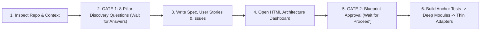

# Greenfield Architecture

Design and build new systems or features with deep modules from Day 1—eliminating reactive refactoring loops.

Read [`PILLARS.md`](PILLARS.md) for the **8 Pillars of Greenfield Architecture** and the 5-Tier Deep Seam model. Read [`DASHBOARD-STYLE.md`](DASHBOARD-STYLE.md) when rendering the visual HTML dashboard.



---

## Phase 1: Context Audit & 8-Pillar Discovery (**Gate 1 — Stop for Answers**)

1. **Audit the environment first**: Inspect the repository (`package.json`, schema files, existing directory layout, and user prompt) to extract every architectural fact already decided. Never ask the human what the codebase already answers.
2. **Identify unresolved gaps across the 8 Pillars**:
   - **Pillar 1 (Entities & Cardinality)**: Core domain entities, `1:1` / `1:N` / `N:M` relations, hierarchy/polymorphism, composite read rollups.
   - **Pillar 2 (Invariants & Lifecycle)**: Non-negotiable compliance rules (audit trail, revision history, soft-delete), valid state transitions (`draft -> published -> archived`), and atomic transaction cascades.
   - **Pillar 3 (External Boundaries)**: Third-party APIs/SDKs/queues, retry/fallback behavior when an integration is down, and PII/secret masking rules.
   - **Pillar 4 (Authorization & Tenancy)**: Actor roles, single- vs. multi-tenant isolation boundaries, and failure envelopes for unauthorized requests.
   - **Pillar 5 (State & Interaction)**: Multi-step workflows/forms, validation & optimistic update behavior, and client search/filtering needs.
   - **Pillar 6 (Locality & Subsystems)**: Single-route components vs. shared domain subsystems and their public barrel facades.
   - **Pillar 7 (Projections & Caching)**: High-traffic read paths, N+1 prevention projections, and caching tiers (edge, memory, store).
   - **Pillar 8 (Anchor Quality Gates)**: Hard architectural invariants to assert in tests (e.g., zero storage imports in delivery routes, coverage bar $\ge 85\%$) and critical E2E journeys.
3. **Ask focused discovery questions and STOP**:
   - Group only the genuinely unresolved questions concisely (use the `ask_question` tool if available, or present a brief, structured list proposing sensible defaults).
   - **Gate 1 Completion Criterion**: End your turn immediately after asking the discovery questions so the human can answer before any spec or dashboard is generated. (Skip Gate 1 only if the user's prompt already specifies all applicable pillars in full.)

---

## Phase 2: Specification, User Stories & Visual Dashboard

Once the human answers the discovery questions, set `PROJECT_NAME` to the repository/project slug (`basename "$(git rev-parse --show-toplevel 2>/dev/null || pwd)"`) and `OUT_DIR="$HOME/private/tmp/${PROJECT_NAME}"`.

### 1. System Architecture Specification (`${OUT_DIR}/specs/ARCHITECTURE-SPEC.md` and `docs/specs/ARCHITECTURE-SPEC.md`)
Document the authoritative blueprint following [`PILLARS.md`](PILLARS.md):
- Entity relationship diagram and domain types.
- 5-Tier seam map: Thin Delivery Adapters (<30 lines), Declarative Policy Guards, Deep Domain Modules, Anti-Corruption Gateways, and Headless State Models.
- Transactional boundaries and invariant cascades.

### 2. Vertical User Stories & Issues (`${OUT_DIR}/issues/US-<NUMBER>-<SLUG>.md`)
Decompose the blueprint into vertical slices. Every story must carry checkable `Given / When / Then` acceptance criteria:

```markdown
### US-[NUMBER]: [Title]
**As a** [Actor] | **I want to** [Action] | **So that** [Outcome]

#### Acceptance Criteria:
- [ ] **AC-1**: Given [Precondition], When [Action], Then [Observable Result].
- [ ] **AC-2**: [Edge case / error envelope / permission rejection].
- [ ] **AC-3**: [Pillar invariant assertion: audit / transaction / gateway isolation].
```

If GitHub CLI (`gh`) or GitHub MCP is authenticated and the user requested remote tracking, publish the issues to the repository.

### 3. Human-Facing HTML Dashboard (`${OUT_DIR}/architecture-dashboard.html`)
Compile the blueprint and user stories into a self-contained HTML file following [`DASHBOARD-STYLE.md`](DASHBOARD-STYLE.md) (plain-English cards, zero academic jargon, working Mermaid ESM script) including:
- **Executive Summary Header**: Project name, domain count, story count, and anchor test targets.
- **Domain Subsystem Cards**: Plain-English *Problem / Fix / Why* breakdown plus public interface signatures and hidden invariants.
- **Before vs. After Blueprints**: Side-by-side `<pre class="mermaid">` diagrams contrasting shallow direct-coupling against the proposed deep seams.
- **User Story Explorer & Execution Roadmap**: Collapsible cards for each `US-XX` and ordered implementation tiers.

Automatically open the dashboard in the user's browser:
```bash
open "${OUT_DIR}/architecture-dashboard.html"
```

---

## Phase 3: Blueprint Confirmation (**Gate 2 — Stop & Wait**)

> [!IMPORTANT]
> **MANDATORY PAUSE GATE**: After writing the specs, user stories, and opening `architecture-dashboard.html`, end your turn and wait for explicit human confirmation before creating or editing any production source or test files.

Present this summary and stop:
```text
I have compiled the architecture specification, decomposed the user stories, and opened the visual Architecture Dashboard in your browser:

- Dashboard: ~/private/tmp/{project-name}/architecture-dashboard.html
- Specifications: ~/private/tmp/{project-name}/specs/
- User Stories: ~/private/tmp/{project-name}/issues/

Please review the domain seams and user stories. Reply "Proceed" to begin implementation, or let me know any adjustments to make first.
```

---

## Phase 4: Greenfield Construction (Post-Confirmation)

As soon as the user approves, transition directly into writing code in this exact sequence:

1. **Scaffold Anchor Truth Tests (`RED`)**: Write deterministic tests asserting architectural boundaries (e.g., delivery routes import only domain facades, zero circular dependencies) and core domain invariants.
2. **Build Deep Modules & Anti-Corruption Gateways**: Implement domain repositories (encapsulating transactions, audit logs, and lifecycle rules) and external gateways (with in-memory test fakes) until unit and invariant tests turn `GREEN`.
3. **Wire Declarative Guards & Thin Delivery Adapters**: Implement higher-order auth/tenancy guards, headless state hooks/models, and thin delivery routes/views (<30 lines each).
4. **Verify Complete Green State**: Run the test runner, typechecker, and linter once to confirm 100% passing tests and $\ge 85\%$ coverage across all new modules.
