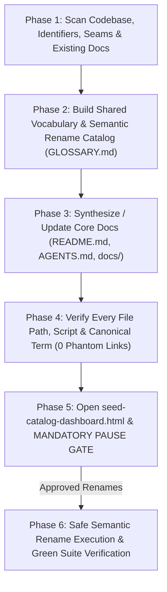

# Seed Catalog (`/seed-catalog`)

Establish a single, authoritative **shared vocabulary** so humans and AI agents use the exact same names when referring to domain entities, deep modules, and architectural seams; propose high-clarity **semantic renames for functions, classes, and files** that suffer from vague or drifted naming; and synthesize or overhaul the repository's core documentation (`GLOSSARY.md`, `README.md`, `AGENTS.md`, and `docs/`) so it is 100% verified against the codebase.

Read [`CATALOG-STANDARDS.md`](CATALOG-STANDARDS.md) for vocabulary, semantic rename rules, and documentation templates, [`../greenfield-architecture/PILLARS.md`](../greenfield-architecture/PILLARS.md) for the **8 Pillars & 5-Tier Seam Taxonomy**, and [`../greenfield-architecture/DASHBOARD-STYLE.md`](../greenfield-architecture/DASHBOARD-STYLE.md) for HTML dashboard formatting.



---

## Phase 1: Codebase Inventory, Identifier & Terminology Audit

1. **Choose Scan Mode by Repository Size**:
   - **Small / Medium Repo (<50 source files)**: Inspect schemas, domain directories, routes, gateways, exported classes/functions, and existing docs directly.
   - **Large / Multi-Subsystem Repo**: Spawn 2–3 concurrent read-only `research` subagents (`invoke_subagent` in a single call) to inventory:
     1. **Domain & Schema Scanner**: Database schemas, domain models/types (Pillar 1), and repositories (Pillar 2).
     2. **Seam, Subsystem & Identifier Scanner**: Delivery adapters, policy guards (Pillar 4), external gateways (Pillar 3), headless state models (Pillar 5), barrel entrypoints (Pillar 6), and poorly named files, classes, and functions.
     3. **Documentation & Spec Scanner**: Existing `README.md`, `GLOSSARY.md`, `AGENTS.md` / `CLAUDE.md`, `docs/`, `package.json` / build manifests, and—if present from prior runs—`docs/specs/ARCHITECTURE-SPEC.md` or `docs/specs/SPEC-*.md` (`/seed-catalog` works 100% standalone when no specs exist, and ingests them when present).
2. **Identify Vocabulary Drift, Opaque Identifiers & Documentation Gaps**:
   - **Synonym Collisions**: Spot concepts called by multiple competing names across database tables, API routes, UI views, and docs (e.g., *Tenant* vs. *Workspace* vs. *Organization* vs. *Account*).
   - **Vague Module Labels**: Spot modules casually referred to as generic "services", "helpers", or "components" instead of their concrete **Deep Module / 5-Tier Seam Role** (`Thin Delivery Adapter`, `Declarative Policy Guard`, `Deep Domain Module`, `Anti-Corruption Gateway`, `Headless State Model`).
   - **Opaque File, Class & Function Names**: Flag grab-bag files (`utils.ts`, `helpers.ts`, `manager.ts`), vague functions (`processData()`, `handleItem()`, `doWork()`, `check()`), and identifiers using retired synonyms instead of the canonical domain vocabulary.
   - **Stale or Missing Documentation**: Identify missing core docs, broken file/script references, and stale "sediment" that no longer matches the codebase.

*(If genuine business-concept ambiguity exists that cannot be resolved from the code alone, ask the human a brief clarifying question and wait; otherwise proceed directly.)*

---

## Phase 2: Canonical Shared Vocabulary & Semantic Rename Catalog (`GLOSSARY.md`)

Create or update `GLOSSARY.md` at the repository root (and `GLOSSARY-MAP.md` if the repository is a multi-context monorepo) following [`CATALOG-STANDARDS.md`](CATALOG-STANDARDS.md):

1. **Section 1 — Domain Ubiquitous Language**:
   - Define each core business entity, value object, and lifecycle state in 1–2 tight sentences.
   - Link each term to its authoritative type/schema file (`file/path.ts`).
   - List retired synonyms under `_Avoid_:` so humans and agents converge on one term per concept.
2. **Section 2 — Deep Module, Subsystem & Seam Catalog (5-Tier Seam Taxonomy)**:
   - Map every major deep module, gateway, guard, headless state model, and delivery adapter in the project into a structured catalog table recording:
     - **Canonical Name** (e.g., `CommentaryRepository`, `HubSpotGateway`, `SessionGuard`, `useOrderWizard`)
     - **5-Tier Seam Role** (`Thin Delivery Adapter`, `Declarative Policy Guard`, `Deep Domain Module`, `Anti-Corruption Gateway`, or `Headless State Model`)
     - **Public Interface / Barrel** (`src/domains/.../index.ts`)
     - **Plain-English Responsibility & Invariants**
     - **`_Avoid_` Labels** (informal or deprecated names to retire)
3. **Section 3 — Semantic Rename Recommendations (Functions, Classes & Files)**:
   - Propose concrete, higher-clarity names for ambiguous or drifted **files, classes, and functions** across the codebase:
     - Map each candidate's **Kind** (`File`, `Class`, `Function`), **Current Name & `file:line`**, **Suggested Canonical Name**, **Aligned Glossary Term / 5-Tier Seam**, **Plain-English Rationale**, and **Caller Count (Blast Radius)**.
     - Ensure every suggested name pairs a canonical domain noun from Section 1 with an explicit action verb or 5-Tier Seam role from Section 2 (e.g., `utils/org-helper.ts` $\rightarrow$ `domains/workspace/workspace-repository.ts`; `processItem()` $\rightarrow$ `publishValidatedOrder()`).

---

## Phase 3: Core Documentation Synthesis & Modernization

Using the canonical terms established in `GLOSSARY.md`, create or update the project's core documentation following [`CATALOG-STANDARDS.md`](CATALOG-STANDARDS.md):

1. **`README.md` (Human & Developer Entrypoint)**:
   - **Executive Summary**: Clear, plain-English statement of what the project is and the problems it solves.
   - **Visual System Architecture**: Mermaid diagram illustrating the subsystems, external gateways, and data flow using exact `GLOSSARY.md` names.
   - **Subsystem Directory & Seam Map**: Scannable table linking each subsystem barrel to its purpose.
   - **Verified Quick-Start & Commands**: Exact install, development, test, and build commands verified against `package.json` / `Makefile` / `Cargo.toml`.
2. **`AGENTS.md` / `CLAUDE.md` (High-Signal Agent Context Pointers)**:
   - Add a front-loaded context pointer to `GLOSSARY.md` requiring agents to use canonical domain and subsystem names.
   - Document non-negotiable 8-Pillar architectural invariants (where seams live, how guards and gateways are wired, and how tests are run).
   - **Prune Sediment & No-Ops**: Delete stale paths, duplicated prose, and generic instructions the model obeys by default so the always-loaded context file stays tight (<80 lines).
3. **`docs/ARCHITECTURE.md` (When Needed for Complex Repos)**:
   - Disclose deep reference diagrams (entity relationships, transactional cascades, projection/caching pipelines) behind a pointer from `README.md` and `AGENTS.md`.

---

## Phase 4: Deterministic Documentation Verification

Run a verification pass across all created and updated documentation files:
1. **Path & Link Integrity Check**: Programmatically verify that every relative markdown link, file path, and directory referenced in `GLOSSARY.md`, `README.md`, `AGENTS.md`, and `docs/` exists on disk (`0` broken links or phantom files).
2. **Command Verification**: Confirm every CLI script documented in `README.md` and `AGENTS.md` exists in the project's manifest (`package.json`, `Makefile`, etc.).
3. **Vocabulary Alignment Check**: Confirm that `README.md`, `AGENTS.md`, and `docs/` consistently use the canonical `GLOSSARY.md` terms and contain zero unquoted uses of banned `_Avoid_` synonyms.

---

## Phase 5: Visual HTML Seed Catalog Dashboard & Pause Gate

Set `PROJECT_NAME` (`basename "$(git rev-parse --show-toplevel 2>/dev/null || pwd)"`) and `OUT_DIR="$HOME/private/tmp/${PROJECT_NAME}"`.

Compile the project's shared vocabulary, semantic rename proposals, and documentation map into `${OUT_DIR}/seed-catalog-dashboard.html` following [`../greenfield-architecture/DASHBOARD-STYLE.md`](../greenfield-architecture/DASHBOARD-STYLE.md) (plain English, zero academic jargon, live Mermaid ESM script):
1. **Executive Catalog Scorecard**:
   - **Canonical Domain Terms Defined**
   - **Deep Modules & 5-Tier Seams Cataloged**
   - **Synonym Collisions Retired (`_Avoid_` count)**
   - **Semantic Rename Proposals (`Files / Classes / Functions`)**
   - **Documentation Files Created / Updated & Link Verification (`100% Verified`)**
2. **Interactive System & Seam Map (`<pre class="mermaid">`)**:
   - Visual architecture diagram showing how every named subsystem, guard, repository, gateway, and state model connects.
3. **Shared Vocabulary Explorer Cards**:
   - Scannable cards for each **Domain Term** and **Deep Module**, displaying the **Canonical Name badge**, **5-Tier Seam Role**, **Public Barrel Path**, **Plain-English Definition**, and red **`Avoid:` pills** for retired synonyms.
4. **Semantic Rename Proposal Table (`Current Name → Suggested Canonical Name`)**:
   - Scannable table of proposed file, class, and function renames with exact `file:line` locations, caller blast radius, and plain-English explanation of how each rename sharpens the shared vocabulary.

Automatically open the dashboard in the user's browser:
```bash
open "${OUT_DIR}/seed-catalog-dashboard.html"
```

> [!IMPORTANT]
> **MANDATORY PAUSE GATE**: After updating `GLOSSARY.md` / core docs and opening `seed-catalog-dashboard.html`, end your turn. Wait for explicit human confirmation before renaming any source files, classes, or functions in the codebase.

Present this summary and stop:
```text
I have extracted the project's shared vocabulary into GLOSSARY.md, updated the core documentation with 100% verified links, and opened the Seed Catalog Dashboard in your browser:

- Dashboard: ~/private/tmp/{project-name}/seed-catalog-dashboard.html
- Shared Vocabulary & Rename Catalog: GLOSSARY.md
- Core Docs Updated: README.md, AGENTS.md

Reply "Execute Renames" (or specify which items in Section 3 of GLOSSARY.md to apply) if you would like me to perform the proposed file, class, and function renames across the codebase.
```

---

## Phase 6: Safe Semantic Rename Execution (Post-Confirmation, If Requested)

When the human approves executing all or a subset of the Section 3 Semantic Rename Proposals:
1. **Execute Renames & Update Call Sites**: Rename the approved files (`git mv`), classes, and functions across the codebase (directly for small scopes, or via disjoint `self` subagents by subsystem for large repos) and delete obsolete pass-through aliases (applying `/bonsai` Shear 2).
2. **Sync Documentation Paths**: Update the cited file paths and identifier names in `GLOSSARY.md`, `README.md`, `AGENTS.md`, `docs/`, and `seed-catalog-dashboard.html` so Phase 4's `0` broken-link truth holds.
3. **Full Verification**: Re-run the test suite, typechecker, linter, and Phase 4 path integrity check to confirm `100% GREEN`.
