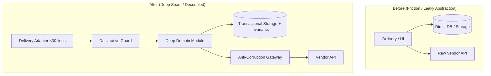

# Pull Request: [Title describing change concisely]

## 1. Traceability & Context
- **Related Spec**: `[docs/specs/SPEC-ID-name.md]` (or Issue / Ticket `#123`)
- **Primary Domain / Subsystem**: `[e.g., Auth, Storage, Billing, Content, UI]`
- **Refactoring Type**: `[Greenfield Feature | /deforestation Seam Overhaul | /bushog Bug Batch | /bonsai Code & Dependency Pruning | /seed-catalog Vocabulary & Docs]`

---

## 2. Summary of Changes
- **Problem Solved**: [Why was this change necessary? What architectural friction or bug was resolved?]
- **Architectural Solution**: [How was this built using deep modules, anti-corruption gateways, or headless hooks?]
- **Involved Files & Seams**:
  - `path/to/module.ts` (Deep Domain Module / Repository)
  - `path/to/adapter.ts` (Thin Delivery Adapter)
  - `path/to/hook.ts` (Headless State Model)

---

## 3. Structural Before / After


---

## 4. Acceptance Criteria Verification Matrix

| Acceptance Criteria (from Spec / Ticket) | Implementation Status | Evidence / Verification Test |
| :--- | :--- | :--- |
| **AC-1**: [Criterion description] | `PASSED` / `VERIFIED` | `path/to/test.ts#L45` |
| **AC-2**: [Criterion description] | `PASSED` / `VERIFIED` | `path/to/test.ts#L78` |
| **AC-3**: [Criterion description] | `PASSED` / `VERIFIED` | `path/to/test.ts#L112` |

---

## 5. The 8-Pillars Compliance Scorecard

- [ ] **Pillar 1 (Entities & Types)**: Explicit domain typing with zero `any` or loose casts.
- [ ] **Pillar 2 (Invariants & Compliance)**: Atomic cascades, audit logs, and versioning snapshots executed within transaction.
- [ ] **Pillar 3 (External Boundaries)**: External services isolated behind domain-native Anti-Corruption Gateways.
- [ ] **Pillar 4 (Authorization & Guards)**: Permissions enforced declaratively via higher-order wrappers (`withRole()`).
- [ ] **Pillar 5 (Headless State & UI)**: UI state, validation, and optimistic updates decoupled into headless hooks.
- [ ] **Pillar 6 (Locality & Barrels)**: Single-consumer files co-located; shared subsystems exported via clean `index.ts`.
- [ ] **Pillar 7 (Projections & Performance)**: Zero N+1 queries; composite projections utilized.
- [ ] **Pillar 8 (Anchor Quality Gates)**: 100% Zero-Storage in delivery routes; statement/branch test coverage >=85%.

---

## 6. Test Verification & Proof
```
[Paste output of test runner showing 100% passing tests and coverage metrics]
```
