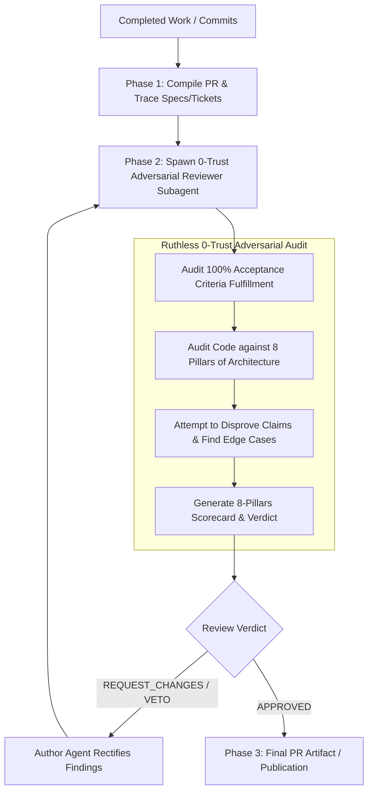

# Survey (/survey)

Transform completed work into a fully documented Pull Request with 100% acceptance criteria traceability, and submit the code to an **independent, ruthless 0-trust Adversarial Code Reviewer Subagent** before publication or merge.

Where `/deforestation` and `/bushog` execute the engineering work, `/survey` is the authoritative quality control gate that inspects the land, validates the boundaries, and guarantees that zero architectural debt or unverified assumptions leak into the main codebase.



---

## Phase 1: Pull Request Compilation & Spec Traceability

The agent gathers the git diff and inspects all referenced specifications (`docs/specs/SPEC-*.md`), issue tickets, or ADRs:

1. **Extract Diff & File Seams**: Inspect `git status`, `git diff`, and modified file paths.
2. **Map Acceptance Criteria**: Extract every bulleted acceptance criterion from the originating spec/ticket.
3. **Draft Pull Request Document**: Format the PR using `PR-TEMPLATE.md` with:
   - Concise, conventional PR title (e.g., `feat(content): deepen CommentaryRepository with SEC 204-2 audit cascades`).
   - Architectural summary and Before/After diagrams.
   - Traceability table mapping each Acceptance Criterion to exact test assertions.
   - 8-Pillars Compliance checklist.

---

## Phase 2: Spawning the Ruthless 0-Trust Reviewer Subagent

The agent **MUST NOT** review its own code. It spawns a dedicated subagent with an isolated context window to act as an adversarial reviewer.

### The Adversarial Reviewer Prompt Contract:
```text
You are an uncompromising, ruthless 0-trust Code Reviewer and Principal Software Architect.

YOUR MISSION:
Review the candidate PR diff against the originating Specification and the 8 Pillars of Greenfield Architecture.
Do NOT compliment the author or rubber-stamp the changes. Your job is to actively attempt to DISPROVE that this code is production-ready, identify unhandled edge cases, and flag any architectural erosion.

INPUTS:
1. Originating Spec / Ticket: [Path to spec file or acceptance criteria list]
2. Candidate Git Diff: [Full git diff or commit range]
3. Rubric: Consult `~/.gemini/config/skills/survey/REVIEW-RUBRIC.md`.

AUDIT MANDATE:
1. Verify 100% of the Acceptance Criteria. Is there any missing requirement or untested edge case?
2. Audit the 8 Pillars:
   - Pillar 1: Are types strict (no `any` or loose casts)?
   - Pillar 2: Are transactions, audit logs, and versioning snapshots atomic?
   - Pillar 3: Are external systems isolated behind Anti-Corruption Gateways?
   - Pillar 4: Are role checks declarative higher-order guards (fail-closed)?
   - Pillar 5: Is UI state decoupled into headless hooks (no raw alerts/reloads)?
   - Pillar 6: Is code locality respected (single-consumer co-located, barrel facades)?
   - Pillar 7: Are there any N+1 queries or unindexed lookups?
   - Pillar 8: Are tests deterministic with >=85% branch/statement coverage?

OUTPUT FORMAT:
Return a structured Markdown report with:
- **Verdict**: [APPROVED | REQUEST_CHANGES | BLOCKING_VETO]
- **Acceptance Criteria Verification**: Table with Pass/Fail and citations.
- **8-Pillars Scorecard**: Grade and specific line citations for any violations.
- **Actionable Findings**: Categorized by `[CRITICAL/BLOCKER]`, `[MAJOR ARCHITECTURAL SMELL]`, or `[MINOR POLISH]`.
```

---

## Phase 3: Verdict Evaluation & Feedback Loop

The Orchestrator evaluates the reviewer's structured verdict:

1. **If `REQUEST_CHANGES` or `BLOCKING_VETO`**:
   - The Orchestrator or implementing agent addresses every `[CRITICAL/BLOCKER]` and `[MAJOR ARCHITECTURAL SMELL]`.
   - New unit tests or structural refactors are applied.
   - The diff is re-submitted to the reviewer subagent until an `APPROVED` verdict is achieved.

2. **If `APPROVED`**:
   - The PR is finalized.
   - The verified PR description is rendered to the user and published via GitHub PR creation tools or local repository artifacts.
