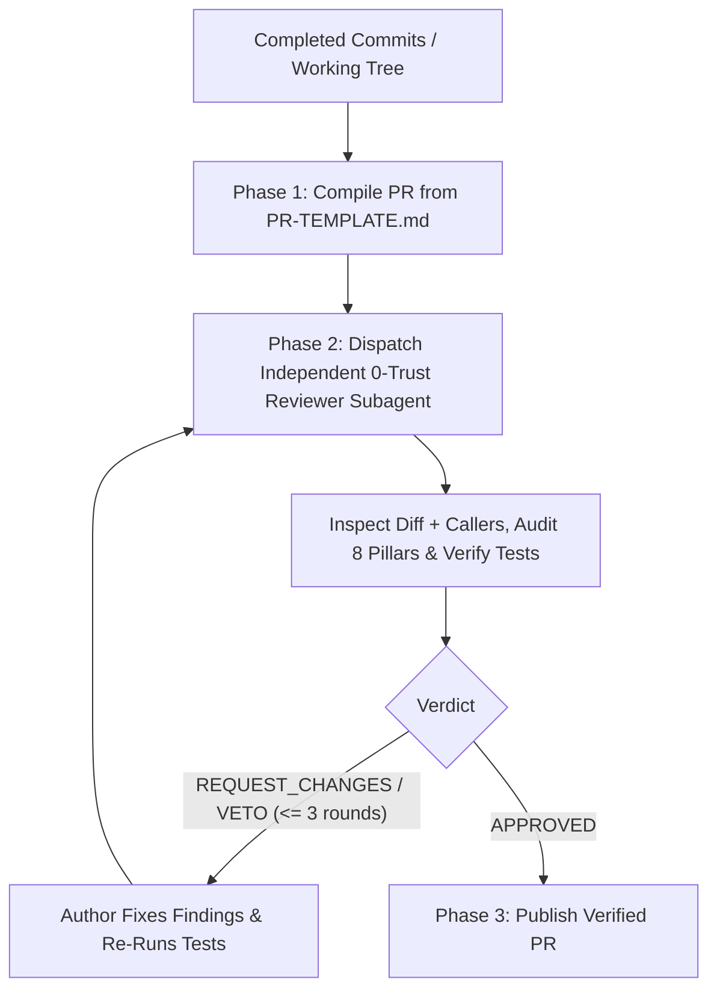

# Survey (`/survey`)

Compile completed engineering work into a traceable Pull Request and subject the changes to an **independent, zero-trust Adversarial Reviewer subagent** before publishing or merging.



---

## Phase 1: Pull Request Compilation & Traceability

1. **Inspect Changes & Originating Context**:
   - Determine the base ref (`BASE_REF`, e.g., `main` or merge-base) and inspect `git status` and `git diff ${BASE_REF}...HEAD --stat`.
   - Locate originating specifications (`docs/specs/SPEC-*.md`), user stories (`US-*`), or issue tickets **when present**. If none exist (e.g., standalone branches, `/bonsai` pruning runs, `/seed-catalog` documentation runs, or ad-hoc `/bushog` fixes), derive the Acceptance Criteria directly from the campaign deliverables or user prompt.
   - Check whether `GLOSSARY.md` exists at the repository root so vocabulary alignment can be verified.
2. **Draft the Pull Request**:
   - Populate [`PR-TEMPLATE.md`](PR-TEMPLATE.md) and save the draft to `~/private/tmp/{project-name}/PR-DRAFT.md`:
     - **Conventional Title**: e.g., `feat(content): encapsulate audit cascades in CommentaryRepository`.
     - **Before / After Mermaid Diagram**: Contrasting prior coupling or bloat with the new seam.
     - **Acceptance Criteria Matrix**: Map every requirement to the exact `file:line` test assertion, diff stat, or verification command that proves it.
     - **Test & Verification Output**: Run the test suite (or link/footprint verification for `/seed-catalog` and `/bonsai`) and record the real output.

---

## Phase 2: Independent Zero-Trust Adversarial Review

Delegate the code audit to an isolated subagent (`invoke_subagent`) so the author context never grades its own work. Pass file paths and git refs rather than pasting large diffs inline:

```text
You are an independent, zero-trust Principal Architect performing an adversarial review for /survey.

YOUR MANDATE:
Actively attempt to DISPROVE that the candidate changes satisfy the acceptance criteria, the 8 Pillars of Greenfield Architecture, and any applicable campaign gates (/bonsai or /seed-catalog). Identify unverified claims, missing edge cases, leaky seams, vocabulary drift, and shallow tests.

INPUTS:
1. Review Rubric: Read `~/.gemini/config/skills/survey/REVIEW-RUBRIC.md` (or `skills/survey/REVIEW-RUBRIC.md` in the repo).
2. Originating Spec / Ticket / Campaign Context: `[Path to spec/issue if present, or summary of standalone /bonsai / /seed-catalog / /bushog intent]`
3. Shared Vocabulary (When Present): If `GLOSSARY.md` exists at the repository root, read it to audit terminology compliance.
4. Draft PR & AC Matrix: `~/private/tmp/{project-name}/PR-DRAFT.md`
5. Git Range to Inspect: Run `git diff <BASE_REF>...HEAD` (or inspect uncommitted changes via `git diff HEAD`).

AUDIT STEPS:
1. Verify every Acceptance Criterion in `PR-DRAFT.md` against the actual implementation, test assertions, or verification proofs at the cited lines.
2. Inspect the modified files AND their surrounding callers against all applicable gates in `REVIEW-RUBRIC.md` (8 Pillars, `GLOSSARY.md` vocabulary alignment when present, `/bonsai` net-negative footprint, or `/seed-catalog` zero-phantom-link integrity).
3. Execute the relevant test suite or verification command to confirm checks genuinely pass.

REQUIRED OUTPUT FORMAT:
- **Verdict**: `APPROVED` | `REQUEST_CHANGES` | `BLOCKING_VETO`
- **Acceptance Criteria Audit**: Table showing each AC, `PASS`/`FAIL`, and `file:line` or command evidence.
- **8-Pillars & Campaign Gates Scorecard**: Pass/Fail/N/A per applicable gate with exact `file:line` citations.
- **Findings**: Grouped under `[BLOCKER]`, `[MAJOR SMELL]`, or `[MINOR]` with concrete remediation instructions.
```

---

## Phase 3: Remediation Loop & Publication

Evaluate the reviewer subagent's verdict (maximum **3 review rounds**):

1. **On `REQUEST_CHANGES` or `BLOCKING_VETO`**:
   - Resolve every `[BLOCKER]` and `[MAJOR SMELL]` at the deep module seam and add regression tests for any uncovered edge cases.
   - Update `PR-DRAFT.md` with the new test evidence and re-dispatch the reviewer subagent.
   - If a finding remains disputed after 3 rounds due to an external constraint or spec conflict, surface the trade-off to the human for adjudication.
2. **On `APPROVED`**:
   - Append the verified **0-Trust Review Scorecard** summary to `PR-DRAFT.md`.
   - Create or update the remote GitHub Pull Request (`gh pr create` / `gh pr edit` or GitHub MCP) when a remote repository is configured, and present the final PR summary to the user.
