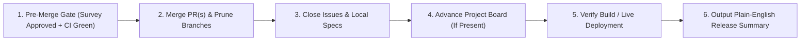

# Tidy (`/tidy`)

Finalize an approved change or stacked campaign: verify pre-merge health, merge PR(s), close linked issues and specs, advance project board items, and confirm production build/deployment health.



---

## Phase 1: Pre-Merge Verification Gate

Confirm all three pre-merge invariants before merging:
1. **Review Approval**: The PR holds an `APPROVED` verdict from `/survey` (or required human reviewers).
2. **Green CI & Local Suite**: Run `gh pr checks <PR>` (if a GitHub PR exists) and verify the local test suite and build pass with 0 errors. If any check is failing, stop and report the failure rather than force-merging.
3. **Clean Merge State**: Confirm `mergeStateStatus` is `CLEAN` (`gh pr view <PR> --json mergeStateStatus,baseRefName`). If behind or conflicted, rebase cleanly and re-verify checks first.

---

## Phase 2: Pull Request Merge & Branch Cleanup

### Single PR
Merge into the base branch and delete the feature branch:
```bash
gh pr merge <PR> --squash --delete-branch
```
*(If operating in a local-only git repository without a GitHub remote, merge into the base branch via `git checkout <base> && git merge --no-ff <branch> && git branch -d <branch>`).*

### Stacked PR Campaign (e.g., from `/deforestation`)
Merge in strict topological order (Tier 1 parent $\rightarrow$ Tier 2 $\rightarrow$ Tier 3 child):
1. Retarget the immediate child PR's base to the main branch before deleting the parent branch:
   ```bash
   gh pr edit <CHILD-PR> --base <MAIN-BRANCH>
   ```
2. Merge the parent PR (`gh pr merge <PARENT-PR> --squash --delete-branch`).
3. Rebase the child PR onto the updated main branch (`gh pr update-branch <CHILD-PR> --rebase`), wait for CI checks to pass, and repeat for the next PR in the stack.

---

## Phase 3: Issue, Story & Spec Closure (When Present)

Locate any tickets, user stories (`US-*`), and specs (`SPEC-*`) linked in the merged PR (if the PR came from `/bonsai`, `/seed-catalog`, or a standalone branch with no linked issues or spec files, skip this phase cleanly and record `N/A`):

1. **Remote GitHub Issues**: Once the merge commit is on the base branch, close each referenced issue (`gh issue close <ISSUE-NUM>`) with a concise resolution comment:
   ```markdown
   Resolved in PR #<PR-NUMBER> (<SHORT-SHA>)
   - **Deep Seam**: `<Module / Gateway / Guard path>`
   - **Verification**: Covered by `<test file path>`
   ```
2. **Local Tracking Files**: If local specs or issue files exist under `~/private/tmp/{project-name}/` or `docs/specs/`, mark their status header as `STATUS: COMPLETED (Merged in <SHORT-SHA>)`.

---

## Phase 4: Project Board Advancement (When Present)

Check whether the PR or closed issues belong to a GitHub Project board:
```bash
gh pr view <PR> --json projectItems
```
If `projectItems` is non-empty, query the project's status field options (`gh project field-list <PROJECT-NUM> --owner <OWNER>`) and move each linked item to **`Done`**. Skip this step cleanly if the repository has no active project board.

---

## Phase 5: Post-Merge Build & Deployment Verification

1. **CI/CD Workflow Watch**: If a post-merge workflow runs on GitHub Actions (`gh run list --branch <MAIN-BRANCH> --limit 1`), watch it to completion:
   ```bash
   gh run watch <RUN-ID> --exit-status
   ```
2. **Live Endpoint Probe**: If a deployment URL is configured or emitted by the workflow, verify it responds cleanly (`curl -sSf -o /dev/null -w "%{http_code}" <DEPLOY_URL>` returning `200`).
3. **Local Build Fallback**: When no remote CI/CD pipeline exists, pull the merged base branch locally and run the production build command (`npm run build`, `cargo build --release`, `go build ./...`, etc.) to confirm a clean release state.

---

## Phase 6: Plain-English Release Summary

Conclude with a concise release report for the human:

```markdown
# Release Finalized (`/tidy`)

- **Merged**: PR #<NUM> — `<Title>` (`<SHORT-SHA>`, feature branch deleted)
- **Closed Issues / Specs**: `<#101, US-01, SPEC-01 | N/A>`
- **Project Board**: `<Moved N items to Done | N/A>`
- **Release Health**: `<CI Run Passed / Local Production Build Green / Live URL 200 OK>`
```
