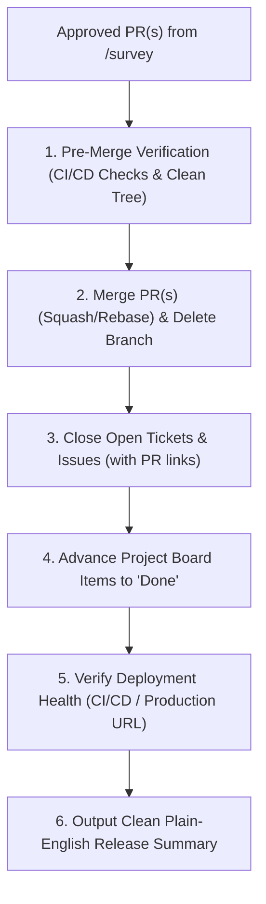

# Tidy (/tidy)

The final lifecycle closure and release management skill. 

Where `/survey` acts as the 0-trust gatekeeper certifying that a Pull Request is architecturally sound and meets 100% of acceptance criteria, `/tidy` executes the **release finalization, merge execution, ticket closure, project board advancement, and deployment verification**.



---

## 1. Operating Protocol & Phases

### Phase 1: Pre-Merge Health & CI/CD Verification
Before merging any Pull Request, the agent **MUST** verify that:
1. **Approval Status**: The PR has received an `APPROVED` verdict from `/survey` (or required reviewers).
2. **CI/CD Checks Pass**: All automated tests, linters, and build checks have passed with 0 failures (`gh pr checks` or GitHub MCP `get_pull_request_status`).
3. **No Merge Conflicts**: The branch is up-to-date with the base branch (e.g., `main` or `release`). If conflicts exist, resolve them cleanly before merging.

---

### Phase 2: Pull Request Merge & Branch Cleanup
Execute the merge following the repository's standard strategy (default: Squash and Merge, or Stacked Rebase for sequential PRs):

```bash
# Using GitHub CLI (or GitHub MCP merge_pull_request):
gh pr merge <PR-NUMBER-OR-BRANCH> --squash --delete-branch
```

If multiple stacked PRs were created during a `/deforestation` campaign:
- Merge each PR in strict topological order from parent to child.
- Ensure each merge succeeds and triggers the next branch rebase automatically.

---

### Phase 3: Ticket & Issue Closure
Identify all specs, user stories, and GitHub Issues referenced in the PR description (e.g., `Closes #101`, `Fixes US-04`, `docs/specs/SPEC-02.md`):

1. **Close Issues**: Update the state of each referenced issue to `Closed`.
2. **Post Closure Summary Comment**: Add a clear, plain-English resolution comment to the issue:
   ```markdown
   ✅ **Resolved in PR #[PR-NUMBER]** ([Commit Hash])
   
   - **Architectural Seam**: Implemented deep module `[Module Name]`.
   - **Acceptance Criteria**: 100% verified via automated test anchor `[Test File Path]`.
   - **Status**: Merged and deployed.
   ```
3. **Local Artifact Update**: If tracking issues locally in `~/private/tmp/{project-name}/issues/`, update issue headers to `[STATUS: CLOSED]`.

---

### Phase 4: Project Board Advancement
If the repository uses a GitHub Project Board (or Kanban board):
1. Locate the card corresponding to the merged PR or closed issues.
2. Move the item from `In Progress` / `In Review` to **`Done`** (or `Released`).

```bash
# Using GitHub CLI project item edit:
gh project item-edit --id <ITEM-ID> --field-id <STATUS-FIELD-ID> --single-select-option-id <DONE-OPTION-ID>
```

---

### Phase 5: Post-Merge Deployment Verification
If a deployment pipeline exists (e.g., Vercel, Netlify, Cloudflare Pages, AWS, Kubernetes, or GitHub Actions deployment workflow):

1. **Watch Deployment Status**: Wait for the post-merge production build and deployment to complete:
   ```bash
   gh run watch --exit-status
   ```
2. **Live Health Check**: If a production or preview URL is emitted by the deployment step:
   - Perform an HTTP GET check (`curl -s -I <DEPLOY_URL>`) to verify HTTP 200 OK.
   - Ensure zero console runtime errors or 500 server crashes.
3. **Local Release Verification**: If running in a local environment without remote CI/CD, run the production build locally (`npm run build`, `cargo build --release`, `go build`, etc.) to guarantee clean production compilation.

---

### Phase 6: Clean Plain-English Release Summary

The agent delivers a clean, plain-English summary to the human:

```markdown
# 🚀 Release Finalized & Tidy Complete

### 1. Merged Pull Requests
- **PR #42**: `feat(content): deepen CommentaryRepository with SEC 204-2 audit cascades` (Merged & Branch Deleted)

### 2. Closed Issues & User Stories
- **Issue #101** (`US-01: Automated Revision History`): Closed with resolution notes.
- **Issue #102** (`US-02: Declarative Admin Guard`): Closed with resolution notes.

### 3. Project Board Status
- 2 items moved to **Done**.

### 4. Deployment Verification
- **CI/CD Pipeline**: Passed (100% Green).
- **Production Build**: 0 warnings, 0 errors.
- **Live Health Check**: `https://app.example.com` responded with `200 OK`.

Everything is clean, merged, tracked, and deployed! 🎉
```

---

## 2. Error Recovery & Safety Rules

- **Never force-merge a failing branch**: If CI checks or tests fail post-approval, abort the merge and report the failure.
- **Never leave stranded remote branches**: Ensure the feature branch is deleted from remote upon merge.
- **Atomic issue tracking**: Do not close an issue unless the code resolving it is confirmed merged into the base branch.
